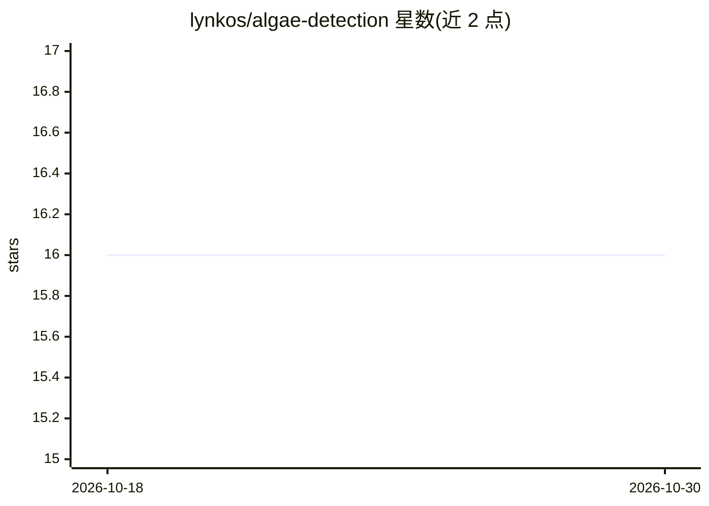

# lynkos/algae-detection

⭐ 16 · C++ · MIT · 推送 2026-04-30 · [GitHub](https://github.com/lynkos/algae-detection) · 个人维护

**用低成本摄像头与 AI 实时检测天然水体中有害藻类的工具**

基于 Ultralytics YOLOv8 微调的实时有害藻类检测项目：通过 ESP32-CAM、智能手机或网络摄像头采集画面，运行检测程序输出带边界框、预测类别与置信度的标注画面，可用 trackbar 实时调节 Confidence、IoU、Max Detections。已在 ESP32-CAM AI Thinker 与 ESP32-S3-EYE 上测试，兼容多种开发板。安装依赖 Conda 创建虚拟环境，克隆仓库后运行 camera.py；训练与验证流程在 Google Colab 与 Roboflow 上进行。面向水质监测、教学与科研场景，默认需配合 Nikon 显微镜与 3D 打印镜头附件等硬件。

## 筛选速览

| 维度 | 判定 | 备注 |
|---|---|---|
| AI 角色 | `ai-native` | 本体是模型或模型工具 |
| 许可风险 | `permissive` | MIT |
| 部署形态 | `None` |  |
| 模型依赖 | — | README 未给出锁定关系 |
| 硬件要求 | — | 无带数字的原话,不猜 |
| 安装摩擦 | `low` | 无编译、无系统依赖或容器化 |
| 成熟度 | — | 结构信号不足 |

## 能力要点

- 微调 YOLOv8 模型检测有害藻类并标注边界框、类别与置信度
- 支持 ESP32-CAM、智能手机、网络摄像头等多种低成本图像来源
- 实时 trackbar 调节 Confidence/IoU/Max Detections
- 提供 Colab 训练验证流程与 Roboflow 数据集支持

## 适用场景

- 我想实时监测水体中有害藻类的种类与分布
- 我想用 ESP32-CAM 等低成本设备搭建水质监测
- 教学或科研中演示 AI 目标检测在水环境的应用

## 场景标签

`目标检测` · 领域:感知与多模态

## 证据(README 行号)

> L24: This project aims to provide a practical, convenient, and efficient tool to monitor water quality and mitigate / pr
> L36:  <figcaption style="font-size: 11px;">Detected algae are annotated with a bounding box, predicted class/category, a

## 星数曲线

2026-10-18 16 → 2026-10-30 16（+0）

---
*卡片 v1 · prompt 1.4 · 生成 2026-10-30 · 置信度 high · 依据 README sha `befd6945d152` · [字段定义](../../DATASET.md)*
