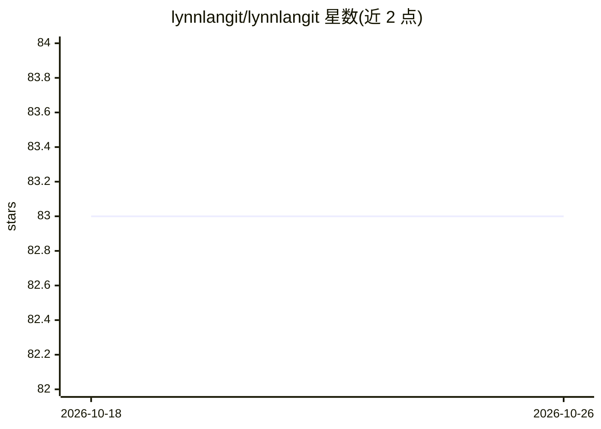

# lynnlangit/lynnlangit

⭐ 83 · Julia · 推送 2026-08-12 · [GitHub](https://github.com/lynnlangit/lynnlangit) · [官网](https://www.lynnlangit.com) · 个人维护

**Lynn Langit 个人 GitHub 主页：云计算与生物信息学学习项目集合**

个人 profile 仓库的 README，以清单形式列出作者在研项目与学习方向，包括 GCP 云计算学习、SnowflakeDB、精准医学 MCP、面向生物信息学的 GCP、生物概念、量子计算、伦理 AI、Gemini 赛道应用、精准农业 MCP 等。内容为链接式索引，无安装或运行说明，属于个人导航页而非可运行的软件项目。

## 筛选速览

| 维度 | 判定 | 备注 |
|---|---|---|
| AI 角色 | `ai-knowledge` | 知识聚合/清单类 |
| 许可风险 | `none` | — |
| 部署形态 | `None` |  |
| 模型依赖 | — | README 未给出锁定关系 |
| 硬件要求 | — | 无带数字的原话,不猜 |
| 安装摩擦 | `low` | 无编译、无系统依赖或容器化 |
| 成熟度 | — | 结构信号不足 |

## 能力要点

- 以链接索引形式列出云计算与生物信息学学习项目
- 涉及精准医学、精准农业两个 MCP 项目方向
- 覆盖 GCP、SnowflakeDB、量子计算、伦理 AI 等学习主题

## 适用场景

- 查看作者公开学习项目与方向的入口导航
- 发现云计算与生物信息学相关的系列内容

## 场景标签

`精选清单` · 领域:学习与行业

## 证据(README 行号)

> L5:  🧬 Precision Medicine MCP
> L13:  🚜 Precision Farm MCP

## 星数曲线

2026-10-18 83 → 2026-10-26 83（+0）

---
*卡片 v1 · prompt 1.4 · 生成 2026-10-24 · 置信度 mid · 依据 README sha `12ed71a50b31` · [字段定义](../../DATASET.md)*
