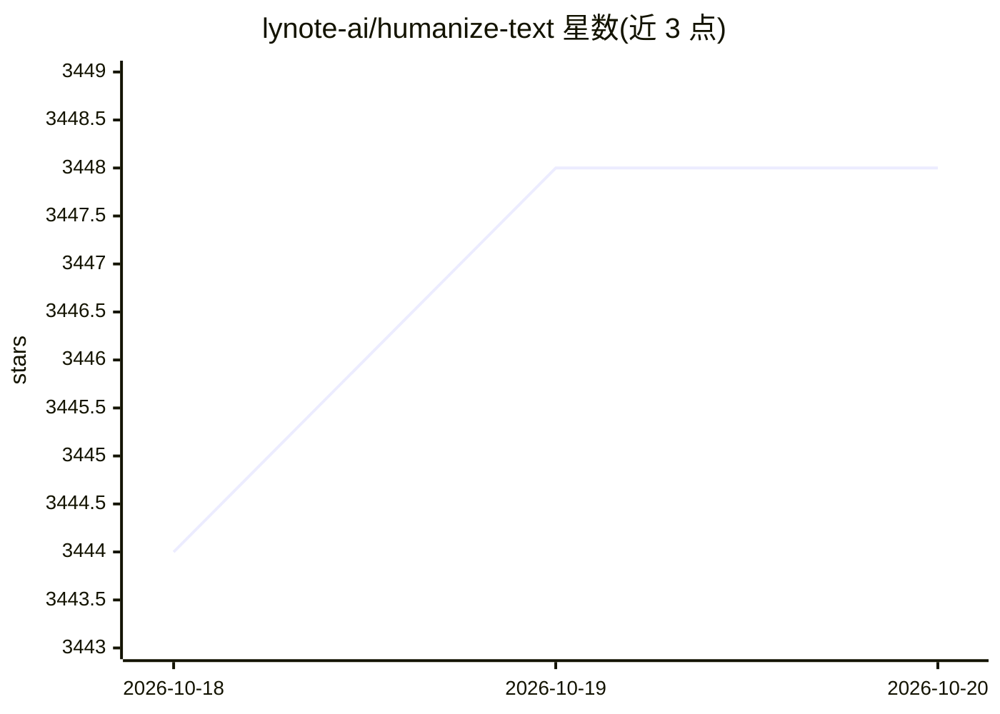

# lynote-ai/humanize-text

⭐ 3,448 · Python · MIT · 推送 2026-10-13 · [GitHub](https://github.com/lynote-ai/humanize-text) · [官网](https://lynote.ai/ai-humanizer) · 组织维护 · 中文 README

**将 AI 生成文本改写为自然人类文风的开源管线**

Lynote 团队开源的 AI 文本人性化改写管线，供需要降低 AI 痕迹的开发者与写作者本地运行。当前方法为 structure-first 数据管线，构建 SFT+KTO 训练数据（不发布权重与端点）；可运行的旧版 v1.x 翻译链为：LLM（DeepSeek 默认，OpenRouter 可选，temp 1.3）中→日两轮改写，再经 Google→Niutrans 两次机器翻译回到英文。提供 three tiers、n8n 工作流导入与 CLI 运行方式；README 明确不保证绕过检测、不得用于隐瞒作者身份，并推广其付费 Lynote.ai 与 Humanizer API。

## 筛选速览

| 维度 | 判定 | 备注 |
|---|---|---|
| AI 角色 | `ai-native` | 本体是模型或模型工具 |
| 许可风险 | `permissive` | MIT |
| 部署形态 | `library` | 以包/库形式分发 |
| 模型依赖 | locked-api |  |
| 硬件要求 | — | 无带数字的原话,不猜 |
| 安装摩擦 | `low` | 无编译、无系统依赖或容器化 |
| 成熟度 | `idea` | |

## 能力要点

- v1.x 翻译链：LLM 双语改写（中→日）+ 双引擎 MT 回译（Google→Niutrans）
- structure-first 数据管线生成 SFT+KTO 训练数据，确定性可审计（SHA256、种子切分、YAML 策略）
- 可配置 LLM 提供方：DeepSeek（默认）/OpenRouter/Atlas Cloud/OrcaRouter，支持 base_url 覆盖
- 提供 n8n 工作流（humanize_standard.json）与 Python CLI 两种运行方式

## 适用场景

- 把 AI 辅助生成的草稿改得更自然、更接近人类写作节奏
- 通过 n8n 无代码工作流批量处理文本
- 复用其训练数据管线方法构建自己的改写模型训练集

## 场景标签

`AI 写作` `模型训练` · 领域:内容生成

## 证据(README 行号)

> L3: **An open-source pipeline for rewriting AI-generated text into natural human prose**
> L28: The current method is a **structure-first data pipeline** that builds the SFT + preference (KTO) training data for 
> L70: python -m src.standard.pipeline --input draft.txt

## 星数曲线

2026-10-18 3,444 → 2026-10-20 3,448（+4）

---
*卡片 v1 · prompt 1.4 · 生成 2026-10-20 · 置信度 mid · 依据 README sha `e04497e30f4d` · [字段定义](../../DATASET.md)*
