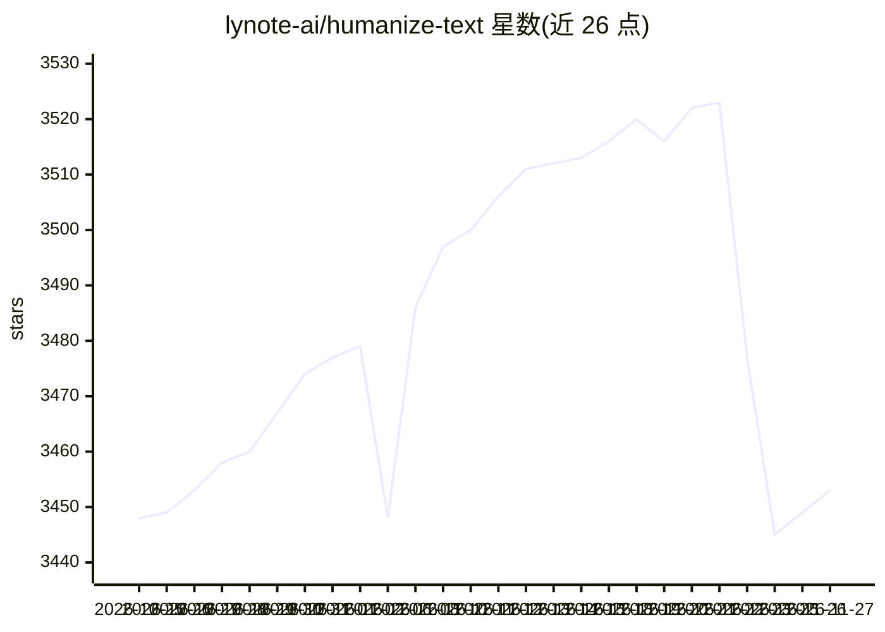

# lynote-ai/humanize-text

⭐ 3,453 · Python · MIT · 推送 2026-10-22 · [GitHub](https://github.com/lynote-ai/humanize-text) · [官网](https://lynote.ai/ai-humanizer) · 组织维护 · 中文 README

**给开发者的 AI 文本改写管线：把 AI 生成文本改写为自然文风**

开源的 AI 文本 humanizer 管线：标准档由两次高温 LLM 改写加两次机器翻译跳转（中文→日文→芬兰语→英文，分别经 Google Translate 与 Niutrans）组成，每一步中间结果可通过 --json/--verbose 追踪。默认使用 DeepSeek，可配置 OpenRouter、Atlas Cloud、OrcaRouter、LiteLLM 或任何 OpenAI 兼容端点。提供 Python CLI、n8n 工作流与 Docker 三种运行方式；另开源自研改写模型的结构优先训练数据管线（代码与策略，不含权重）。使用需自备 LLM 与 Niutrans 的 API key。

## 筛选速览

| 维度 | 判定 | 备注 |
|---|---|---|
| AI 角色 | `ai-native` | 本体是模型或模型工具 |
| 许可风险 | `permissive` | MIT |
| 部署形态 | `self-host` | docker 或自建部署 |
| 模型依赖 | locked-api |  |
| 硬件要求 | — | 无带数字的原话,不猜 |
| 安装摩擦 | `low` | 无编译、无系统依赖或容器化 |
| 成熟度 | — | 结构信号不足 |

## 能力要点

- 2 次 LLM 改写 + 2 次跨引擎翻译的四级改写链，每步可追踪
- 支持 DeepSeek/OpenRouter/Atlas Cloud/OrcaRouter/LiteLLM 及任意 OpenAI 兼容端点
- standard/advanced/focus 三档，focus 含检测引导的反馈回路
- 附结构优先的训练数据管线（SFT→KTO），含策略与测试

## 适用场景

- 让 AI 辅助生成的英文草稿读起来更自然
- 无代码用户通过 n8n 工作流接入文本改写
- 自托管 REST 端点批量处理 AI 生成文本
- 研究 AI 文本特征改写的数据构建方法

## 场景标签

`AI 写作` · 领域:内容生成

## 证据(README 行号)

> L3: **Open-source AI humanizer: rewrite AI-generated drafts into natural, human-sounding prose — and see every step it t
> L51: The open pipeline combines two LLM rewrites with two machine-translation hops across distant languages and differen
> L46: - **Three ways to run it.** Python CLI, a no-code n8n workflow, or Docker.

## 星数曲线

2026-10-25 3,448 → 2026-11-27 3,453（+5）

---
*卡片 v1 · prompt 1.4 · 生成 2026-11-23 · 置信度 high · 依据 README sha `d09220fe7062` · [字段定义](../../DATASET.md)*
