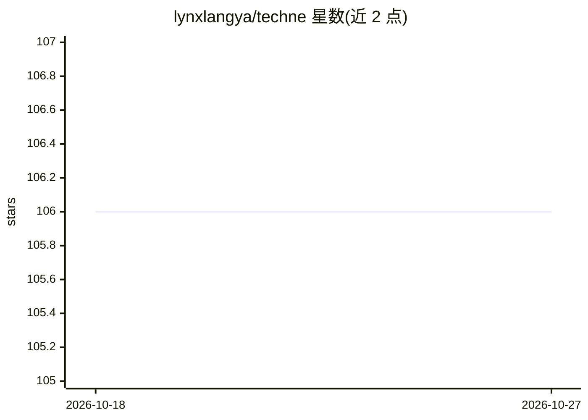

# lynxlangya/techne

⭐ 106 · Python · MIT · 推送 2026-07-02 · [GitHub](https://github.com/lynxlangya/techne) · [官网](https://techne.wangyun.fan) · 个人维护 · 中文 README

**面向 AI 编码 agent 的强制式技能库，锚定工作于证据**

策展的 agent 技能与资产库：每个技能是一段小型程序，强制 AI 协作者以特定认知步骤工作，如先构建失败复现再修 bug、以图表方式调查真实代码库、按固定 rubric 审问实现简报等。技能正文统一存于 skills/ 目录，各宿主（Claude Code、Codex、Cursor、Gemini、Kimi）的清单与安装指令指向同一来源。安装推荐由 AI agent 读取 INSTALL.md 自动完成，也提供 npx skills 回退方式。当前包含 4 个 anchor-* 前缀的种子技能。

## 筛选速览

| 维度 | 判定 | 备注 |
|---|---|---|
| AI 角色 | `ai-ecosystem` | LLM/agent 周边工具 |
| 许可风险 | `permissive` | MIT |
| 部署形态 | `library` | 以包/库形式分发 |
| 模型依赖 | — | README 未给出锁定关系 |
| 硬件要求 | — | 无带数字的原话,不猜 |
| 安装摩擦 | `low` | 无编译、无系统依赖或容器化 |
| 成熟度 | — | 结构信号不足 |

## 能力要点

- 单一 skills/ 真源，多宿主清单复用同一技能正文
- anchor-repro 强制先失败复现再修复并复验
- anchor-viz 将一个请求路由到五类架构图并本地构建查看器
- 支持 Claude Code 插件市场安装与 npx skills 通用回退

## 适用场景

- 让编码 agent 修 bug 前先产出失败复现
- 让 agent 通过制图调查真实代码库结构
- 在开工前审问工程实现简报并产出意图级计划

## 场景标签

`提示工程` · 领域:Agent 开发

## 证据(README 行号)

> L18: techne is a curated library of skills and agent assets for practical AI-era
> L23: The project keeps one shared source of truth in `skills/`. Host-specific files
> L52: **Recommended: ask your AI agent.** Paste this into Claude Code or Codex:

## 星数曲线

2026-10-18 106 → 2026-10-27 106（+0）

---
*卡片 v1 · prompt 1.4 · 生成 2026-10-23 · 置信度 high · 依据 README sha `be314c6e4c5c` · [字段定义](../../DATASET.md)*
