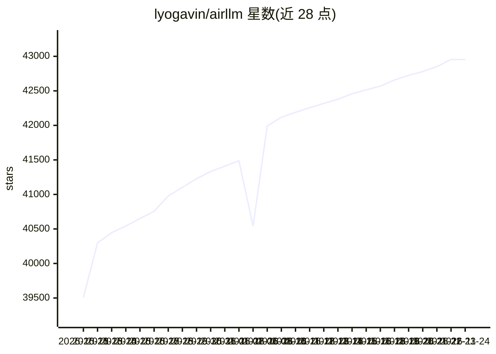

# lyogavin/airllm

⭐ 43,199 · Jupyter Notebook · Apache-2.0 · 推送 2026-11-23 · [GitHub](https://github.com/lyogavin/airllm) · 个人维护

**低显存 GPU 上分层加载运行超大 LLM 的推理库**

AirLLM 通过逐层从磁盘流式加载、任一时刻仅在 GPU 上保留单层模型的方式降低推理显存占用，使 Llama 3.x 70B 全精度可在约 4GB 显存运行，DeepSeek-V3 约 12GB，并支持 FP8 与 4bit/8bit 块级量化压缩加速。以 pip 包形式提供，AutoModel 统一接入 Hugging Face 模型，2026 年起加入 LoRA 微调训练支持，macOS Apple Silicon 可运行 Llama 系架构模型。速度因逐层读盘而较慢，README 自述生成回复耗时较长。

## 筛选速览

| 维度 | 判定 | 备注 |
|---|---|---|
| AI 角色 | `ai-ecosystem` | LLM/agent 周边工具 |
| 许可风险 | `permissive` | Apache-2.0 |
| 部署形态 | `library` | 以包/库形式分发 |
| 模型依赖 | — | README 未给出锁定关系 |
| 硬件要求 | — | 无带数字的原话,不猜 |
| 安装摩擦 | `medium` | 含编译或系统依赖之一 |
| 成熟度 | — | 结构信号不足 |

## 动量与使用信号

- 维护:`active` — 距上次 push 1.1 天,年发版 6,9 位贡献者
- 涨星:近 1 天 **+218**(自 20261016 起算)
- 安装:pypi 包 `airllm` 月下载 5,466
- 平台:MACOS · 协议:—

## 能力要点

- 单层驻留 GPU 的分层流式加载，无需量化/蒸馏/剪枝
- 支持 4bit/8bit 块级量化压缩，最高约 3x 推理加速
- 提供 LoRA 微调：冻结权重逐层流式读取，仅适配器驻留 GPU
- AutoModel 统一接口，覆盖 Llama/Qwen/DeepSeek/Mistral 等主流开源模型族

## 适用场景

- 在 4GB 显存的消费级显卡上运行 70B 级开源大模型
- 本地对超大模型做 LoRA 微调
- 在 Apple Silicon Mac 上运行 Llama/Mistral 系模型

## 场景标签

`推理引擎` `微调` `模型量化` · 领域:训练与推理

## 证据(README 行号)

> L82: Then, initialize AirLLMLlama2, pass in the huggingface repo ID of the model being used, or the local path, and infe
> L203: AirLLM works out of the box with **virtually every popular open LLM** — just pass its Hugging Face ID to `AutoMode
> L209: The trick: AirLLM only ever keeps **one layer on the GPU at a time**, so the VRAM you need depends on the model's 

## 星数曲线

2026-10-21 39,507 → 2026-11-24 42,955（+3,448）

---
*卡片 v1 · prompt 1.4 · 生成 2026-11-24 · 置信度 high · 依据 README sha `7a8d7b9b415f` · [字段定义](../../DATASET.md)*
