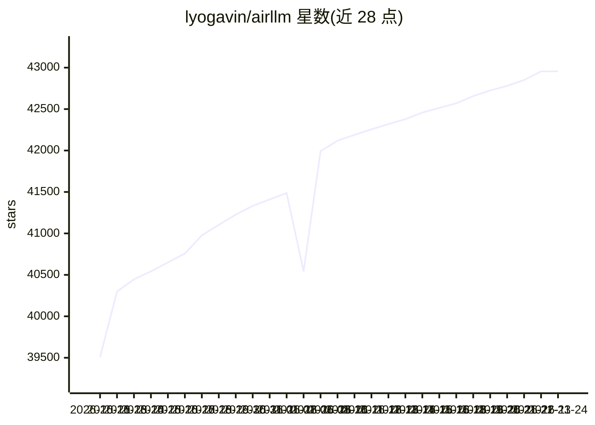

# lyogavin/airllm

⭐ 42,955 · Jupyter Notebook · Apache-2.0 · 推送 2026-11-22 · [GitHub](https://github.com/lyogavin/airllm) · 个人维护 · 中文 README

**分层加载推理库：4GB 显存运行 70B 大模型**

以 Python pip 包形式提供的 LLM 推理内存优化库：通过逐层换入换出的方式，同一时刻只在 GPU 上驻留一个模型层，使显存需求取决于单层大小而非模型总大小，从而在 4GB 显存运行 70B 模型、~12GB 运行 DeepSeek-V3 (671B)。通过 Hugging Face repo ID 或本地路径加载模型，接口仿照 transformers；提供 4bit/8bit 块级量化压缩（官方称最高 3x 提速）、预取、CPU 推理与 macOS（Apple Silicon、仅 Llama/Mistral 架构）支持；推理前需将模型分解为层分片，磁盘开销大。v3.0 起还支持在小显存 GPU 上冻结底座、流式训练并保留 LoRA 适配器。

## 筛选速览

| 维度 | 判定 | 备注 |
|---|---|---|
| AI 角色 | `ai-ecosystem` | LLM/agent 周边工具 |
| 许可风险 | `permissive` | Apache-2.0 |
| 部署形态 | `library` | 以包/库形式分发 |
| 模型依赖 | — | README 未给出锁定关系 |
| 硬件要求 | — | 无带数字的原话,不猜 |
| 安装摩擦 | `medium` | 含编译或系统依赖之一 |
| 成熟度 | — | 结构信号不足 |

## 动量与使用信号

- 维护:`active` — 距上次 push 1.1 天,年发版 6,9 位贡献者
- 涨星:近 1 天 **+218**(自 20261016 起算)
- 安装:pypi 包 `airllm` 月下载 5,466
- 平台:MACOS · 协议:—

## 能力要点

- 逐层流式加载：显存占用取决于模型单层大小而非总参数量
- 4bit/8bit 块级量化压缩，官方称最高 3x 推理加速
- 支持 Llama/Qwen/DeepSeek/Mixtral/ChatGLM 等主流开源模型家族，统一 AutoModel 接口
- 小显存 LoRA 训练：冻结权重逐层从磁盘流式读取，仅适配器驻留 GPU

## 适用场景

- 在消费级显卡上本地推理超大参数量开源模型
- 本地微调 125B 级模型而不升级显存
- 加载 gated Hugging Face 模型并控制模型分片存储路径

## 场景标签

`推理引擎` `模型量化` `微调` · 领域:训练与推理

## 证据(README 行号)

> L9: **AirLLM** dramatically reduces inference memory usage, letting 70B large language models run on a single 4GB GPU ca
> L82: Then, initialize AirLLMLlama2, pass in the huggingface repo ID of the model being used, or the local path, and infe
> L188: The trick: AirLLM only ever keeps **one layer on the GPU at a time**, so the VRAM you need depends on the model's 

## 星数曲线

2026-10-21 39,507 → 2026-11-24 42,955（+3,448）

---
*卡片 v1 · prompt 1.4 · 生成 2026-11-22 · 置信度 high · 依据 README sha `5832f5a0842d` · [字段定义](../../DATASET.md)*
