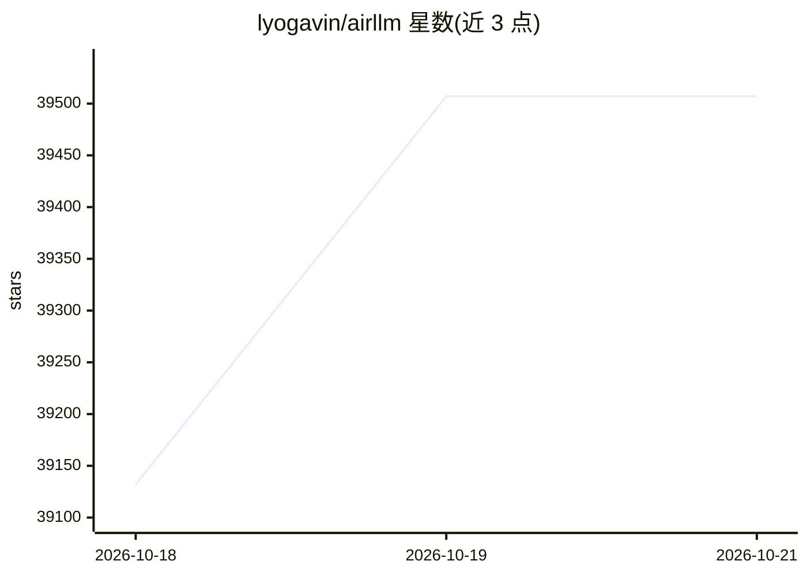

# lyogavin/airllm

⭐ — · [GitHub]() · 个人维护

**让单张 4GB 显卡运行超大 LLM 的推理库**

Python 推理库，通过每次仅在 GPU 上保留一层解码层、逐层从磁盘流式加载的方式降低显存占用，README 称可在 4GB 显存上运行 70B 模型，无需量化、蒸馏或剪枝；v3.0 起支持 FP8，并提供 block-wise 量化压缩（宣称最高 3x 推理加速）。经 pip 安装，通过 AutoModel 传入 Hugging Face 模型 ID 或本地路径使用；推理前会将原模型分层切分保存，需要充足磁盘空间。支持 Apple Silicon 上的 MacOS，并提供小显存 LoRA 微调脚本。

## 筛选速览

| 维度 | 判定 | 备注 |
|---|---|---|
| AI 角色 | `ai-ecosystem` | LLM/agent 周边工具 |
| 许可风险 | `permissive` | — |
| 部署形态 | `library` | 以包/库形式分发 |
| 模型依赖 | — | README 未给出锁定关系 |
| 硬件要求 | — | 无带数字的原话,不猜 |
| 安装摩擦 | `medium` | 含编译或系统依赖之一 |
| 成熟度 | — | 结构信号不足 |

## 动量与使用信号

- 维护:`active` — 距上次 push 1.1 天,年发版 6,9 位贡献者
- 涨星:近 1 天 **+218**(自 20261016 起算)
- 安装:pypi 包 `airllm` 月下载 5,466
- 平台:MACOS · 协议:—

## 能力要点

- 逐层流式加载，使显存需求取决于单层大小而非模型总大小
- 支持 4bit/8bit block-wise 量化压缩（模型加载体积减小）
- 通过 AutoModel 一行代码加载多种开源 LLM
- 提供小显存 LoRA 训练（冻结权重逐层流式、仅适配器驻留 GPU）

## 适用场景

- 在消费级显卡上运行 70B 及以上参数的开源模型推理
- MacOS Apple Silicon 上运行大语言模型
- 小显存环境下对大模型进行 LoRA 微调

## 场景标签

`推理引擎` `微调` · 领域:训练与推理

## 证据(README 行号)

> L9: **AirLLM** dramatically reduces inference memory usage, letting 70B large language models run on a single 4GB GPU ca
> L77: pip install airllm
> L187: The trick: AirLLM only ever keeps **one layer on the GPU at a time**, so the VRAM you need depends on the model's 

## 星数曲线

2026-10-18 39,132 → 2026-10-21 39,507（+375）

---
*卡片 v1 · prompt 1.4 · 生成 2026-10-18 · 置信度 high · 依据 README sha `35838a96a565` · [字段定义](../../DATASET.md)*
