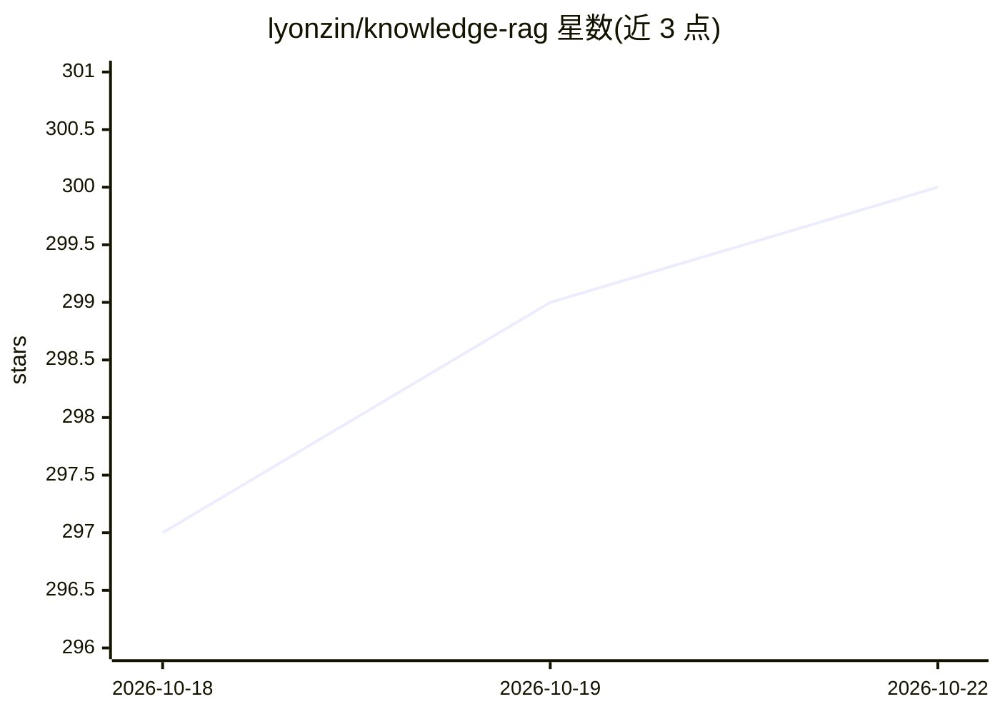

# lyonzin/knowledge-rag

⭐ 300 · Python · MIT · 推送 2026-10-16 · [GitHub](https://github.com/lyonzin/knowledge-rag) · [官网](https://pypi.org/project/knowledge-rag/) · 个人维护

**本地混合检索 RAG MCP 服务器：给 AI 编码代理提供知识库搜索**

以 MCP 服务器形式运行的本地 RAG 系统：嵌入、索引、检索均在本地进程内完成（FastEmbed ONNX + ChromaDB），提供语义+BM25 混合检索与交叉编码器重排，暴露 13 个 MCP 工具供 Claude Code、Cursor、Windsurf、VS Code 等 MCP 客户端调用。支持 stdio/SSE/Streamable HTTP 三种传输，内置 Bearer 认证、Prometheus 指标、限流与单实例锁；另随附 10 个行为技能文件引导代理使用检索。首次查询需下载约 200MB 模型，之后可离线运行。

## 筛选速览

| 维度 | 判定 | 备注 |
|---|---|---|
| AI 角色 | `ai-ecosystem` | LLM/agent 周边工具 |
| 许可风险 | `permissive` | MIT |
| 部署形态 | `self-host` | docker 或自建部署 |
| 模型依赖 | — | README 未给出锁定关系 |
| 硬件要求 | — | 无带数字的原话,不猜 |
| 安装摩擦 | `low` | 无编译、无系统依赖或容器化 |
| 成熟度 | — | 结构信号不足 |

## 能力要点

- 13 个 MCP 工具：混合检索、文档 CRUD、增量重建、检索质量评测（MRR/Recall/Precision@5）
- 嵌入/索引/检索全部本地进程内运行，首次模型下载后可离线使用
- stdio / SSE / Streamable HTTP 三种传输，多客户端共享索引
- 内置 Bearer 认证、Prometheus 指标、路径遍历/符号链接防御

## 适用场景

- 让 Claude Code / Cursor 等编码代理优先检索本地文档再回答
- 团队通过共享 HTTP 服务器复用同一份索引
- 把项目决策、ADR、安全手册索引成可检索知识库

## 场景标签

 · 领域:LLM 基础设施/RAG

## 证据(README 行号)

> L22: ### The MCP-first local RAG server for Claude Code, Cursor, and every AI agent.
> L48: **knowledge-rag is an MCP-native local RAG server** for clients such as Claude Code, Cursor, Windsurf, VS Code, Cli
> L151: Installing knowledge-rag gives your agent 13 MCP tools. It does not tell the agent **when** to use them. That is w

## 星数曲线

2026-10-18 297 → 2026-10-22 300（+3）

---
*卡片 v1 · prompt 1.4 · 生成 2026-10-22 · 置信度 mid · 依据 README sha `b0affd40dfc6` · [字段定义](../../DATASET.md)*
