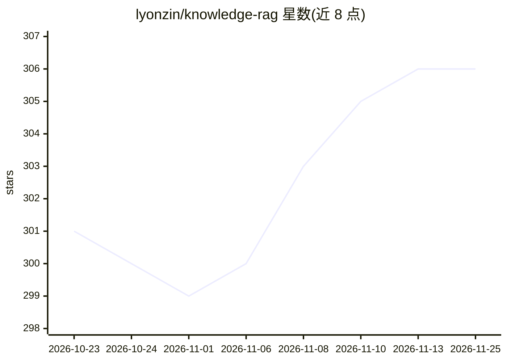

# lyonzin/knowledge-rag

⭐ 306 · Python · MIT · 推送 2026-11-20 · [GitHub](https://github.com/lyonzin/knowledge-rag) · [官网](https://pypi.org/project/knowledge-rag/) · 个人维护

**面向 Claude Code/Cursor 等 MCP 客户端的本地 RAG 检索服务器**

以 MCP 服务器形式运行的本地检索层：解析用户机器上的文档与代码（支持 33 种文件类型），切片嵌入后存入内嵌 ChromaDB，搜索时融合 BM25 关键词与向量检索并用交叉编码器重排，返回文件路径、片段与得分，由客户端模型生成回答，自身不调用 LLM。单 Python 进程内嵌 ChromaDB 与 FastEmbed ONNX 模型，无需 Docker、数据库服务器或 API key；提供 npx 启动器、pip、Docker 及共享 HTTP 服务器多种部署方式。

## 筛选速览

| 维度 | 判定 | 备注 |
|---|---|---|
| AI 角色 | `ai-ecosystem` | LLM/agent 周边工具 |
| 许可风险 | `permissive` | MIT |
| 部署形态 | `desktop` | 安装包/桌面程序 |
| 模型依赖 | — | README 未给出锁定关系 |
| 硬件要求 | — | 无带数字的原话,不猜 |
| 安装摩擦 | `low` | 无编译、无系统依赖或容器化 |
| 成熟度 | — | 结构信号不足 |

## 能力要点

- 混合检索：BM25 + 向量相似度 + Xenova/ms-marco-MiniLM-L-6-v2 交叉编码器重排，默认开启
- 13 个 MCP 工具，支持 33 种文件类型（含代码文件，提取函数/类/导入元数据）
- 文件变更 10 秒后自动重建索引，全程离线可用（模型缓存后）
- 单进程内嵌 ChromaDB 与 FastEmbed ONNX，无需 Docker、数据库服务器或 API key

## 适用场景

- 让 Claude Code/Cursor 直接检索我本地的文档和代码库
- 离线环境下为 AI 编程客户端搭建私有知识检索
- 多个 MCP 客户端共享同一份索引（HTTP 服务器模式）
- 索引随文件变动自动保持最新，无需手动重建

## 场景标签

`RAG` `语义搜索` · 领域:知识与检索

## 证据(README 行号)

> L9: **knowledge-rag** is a local retrieval-augmented generation (RAG) server for the Model Context Protocol (MCP). It in
> L74: 4. **Answer.** Results go back to the MCP client with the file path, chunk index, snippet and scores. The client's 
> L9: **knowledge-rag** is a local retrieval-augmented generation (RAG) server for the Model Context Protocol (MCP). It in
> L168: Any client that starts a stdio MCP server from a command, or connects to a Streamable HTTP endpoint, can use knowl

## 星数曲线

2026-10-23 301 → 2026-11-25 306（+5）

---
*卡片 v1 · prompt 1.4 · 生成 2026-11-25 · 置信度 high · 依据 README sha `da3771669dae` · [字段定义](../../DATASET.md)*
