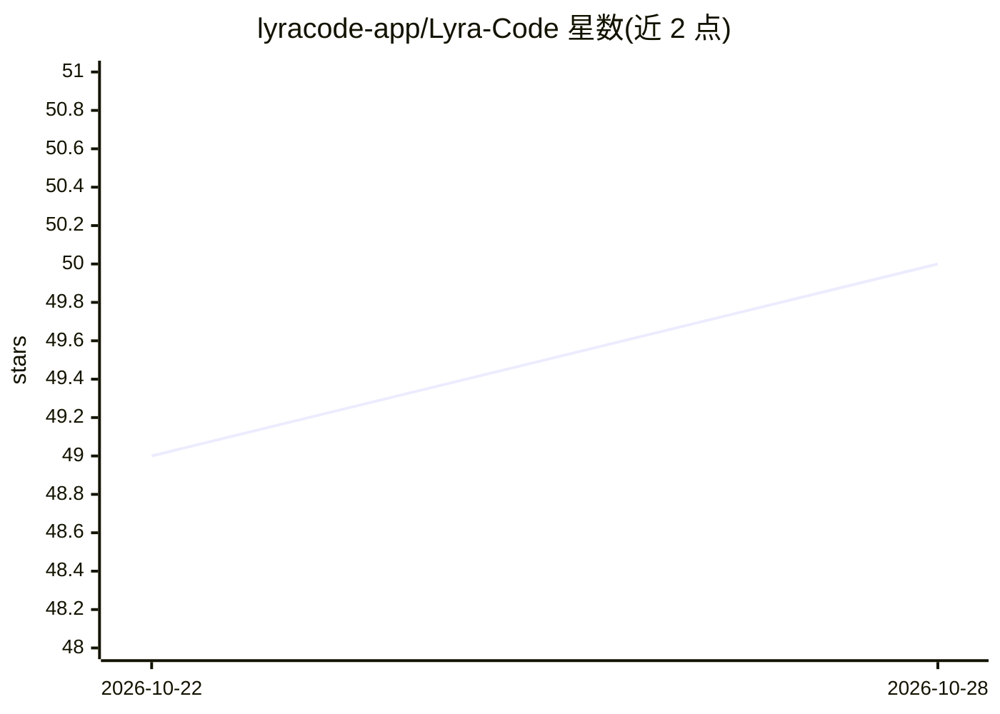

# lyracode-app/Lyra-Code

⭐ 51 · Kotlin · AGPL-3.0 · 推送 2026-10-27 · [GitHub](https://github.com/lyracode-app/Lyra-Code) · [官网](https://lyracode.app) · 组织维护 · 中文 README

**Android 上的 AI 全栈开发环境：PRoot Linux + Termux + 编程 Agent**

Android 应用，内置 Agent 在应用管理的 PRoot Linux 环境或已有 Termux 中编辑项目、安装工具链、执行命令、构建测试与调试。支持 OpenAI 兼容、Anthropic、Gemini API；通过 Termux RunCommandService 调用外部 Termux。附带代码编辑器、文件管理、MCP 客户端/服务端、设备自动化（Shizuku/Root 可选）、Web 远程访问等。PRoot 非虚拟机、无 root；构建需 JDK 17 与 Android SDK，最低 Android 8.0。

## 筛选速览

| 维度 | 判定 | 备注 |
|---|---|---|
| AI 角色 | `ai-native` | 本体是模型或模型工具 |
| 许可风险 | `viral` | AGPL-3.0 |
| 部署形态 | `None` |  |
| 模型依赖 | — | README 未给出锁定关系 |
| 硬件要求 | — | 无带数字的原话,不猜 |
| 安装摩擦 | `medium` | 含编译或系统依赖之一 |
| 成熟度 | — | 结构信号不足 |

## 能力要点

- Agent 在 PRoot Linux 或 Termux 内执行编辑、构建、测试与调试
- 支持 OpenAI 兼容/Anthropic/Gemini API 与 MCP 客户端/服务端
- Sora 编辑器、双栏文件管理、离线 AI 图表与 SVG 预览
- 设备自动化（Shizuku/无障碍/图像识别）与 Web 远程访问

## 适用场景

- 在手机上搭建并运行 Linux 全栈开发环境
- 让 Agent 在本地环境完成代码编辑、构建与调试
- 通过桌面浏览器远程操作手机上的会话与文件

## 场景标签

`编码 Agent` · 领域:编码与开发

## 证据(README 行号)

> L17: Lyra Code turns an Android device into an AI-assisted full-stack development environment. Its core is not just chat
> L29: - **Agent-driven coding loop:** use OpenAI-compatible, Anthropic, or Gemini APIs to search, read, edit, and review 

## 星数曲线

2026-10-22 49 → 2026-10-28 50（+1）

---
*卡片 v1 · prompt 1.4 · 生成 2026-10-24 · 置信度 high · 依据 README sha `70ca57843f53` · [字段定义](../../DATASET.md)*
