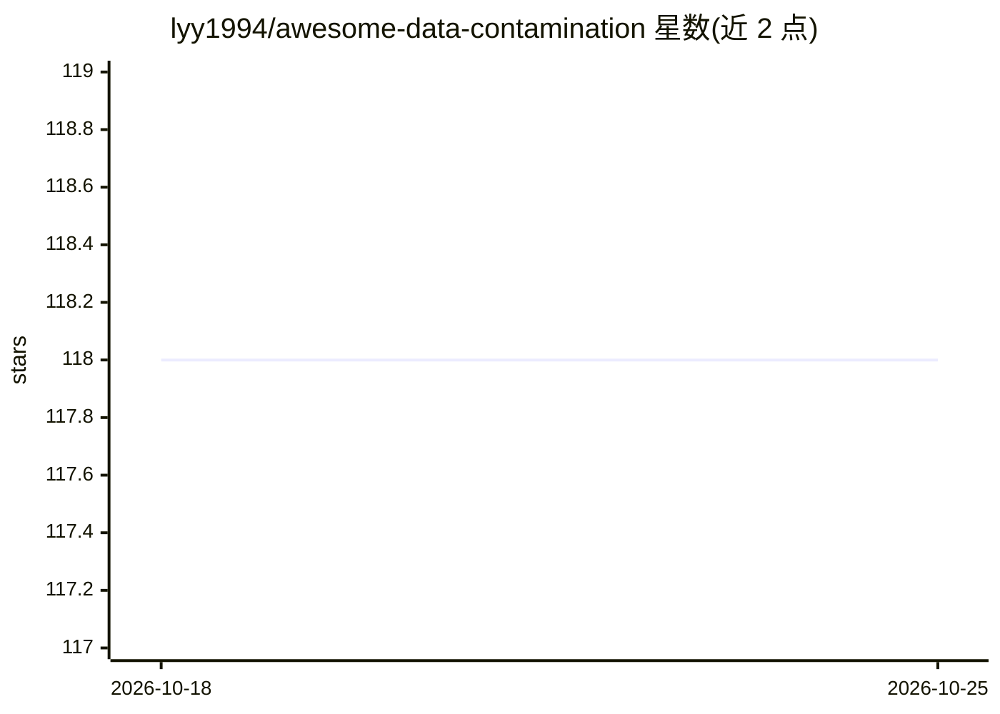

# lyy1994/awesome-data-contamination

⭐ 118 · MIT · 推送 2026-09-28 · [GitHub](https://github.com/lyy1994/awesome-data-contamination) · 个人维护

**面向 LLM 评测的数据污染（data contamination）论文清单**

Awesome Data Contamination 维护大语言模型评测中数据污染问题的论文列表：数据污染指模型在训练时见过测试集信息（如测试实例、测试提示）从而导致评测结果虚高。清单为每篇论文打标签（检测、预防、分析、系统/软件、数据集、综述、多模态），按论文首次发布时间排序，每条含作者、发表会议、摘要及编者注。News 区还跟踪维护者的相关工作（SimMIA 成员推断攻击、C2LEVA 双语基准）。仓库为 MIT 许可，仅做文献编目，不含可运行代码。

## 筛选速览

| 维度 | 判定 | 备注 |
|---|---|---|
| AI 角色 | `ai-knowledge` | 知识聚合/清单类 |
| 许可风险 | `permissive` | MIT |
| 部署形态 | `None` |  |
| 模型依赖 | — | README 未给出锁定关系 |
| 硬件要求 | — | 无带数字的原话,不猜 |
| 安装摩擦 | `low` | 无编译、无系统依赖或容器化 |
| 成熟度 | — | 结构信号不足 |

## 能力要点

- 按 7 类标签（检测/预防/分析/系统/数据集/综述/跨模态）组织数据污染论文
- 条目含作者、会议、摘要与编者注说明该文与污染问题的关系
- News 区跟踪 SimMIA 成员推断攻击与 C2LEVA 双语防污染基准

## 适用场景

- 研究 LLM 评测可靠性时查找数据污染相关文献
- 按检测、预防等类别筛选污染处理方法的已有工作
- 了解数据污染问题从 2017 年起的论文脉络

## 场景标签

`模型评测` `精选清单` · 领域:评测与运维

## 证据(README 行号)

> L6: The paper list on data contamination for large language models evaluation.
> L24: ### 🏷️ Tagset

## 星数曲线

2026-10-18 118 → 2026-10-25 118（+0）

---
*卡片 v1 · prompt 1.4 · 生成 2026-10-23 · 置信度 high · 依据 README sha `102289dfd825` · [字段定义](../../DATASET.md)*
