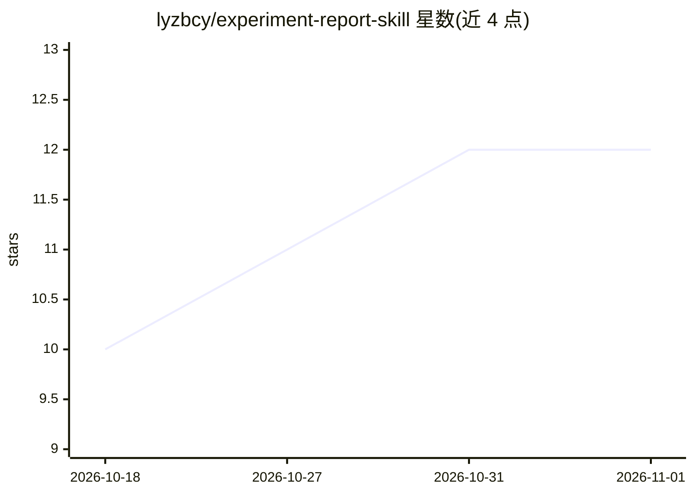

# lyzbcy/experiment-report-skill

⭐ 12 · JavaScript · MIT · 推送 2026-10-28 · [GitHub](https://github.com/lyzbcy/experiment-report-skill) · 个人维护 · 中文 README

**给 AI 编程工具的实验报告生成技能：真实跑实验后交付 md+docx 报告**

以 SKILL.md 形式安装在 ZCode / Claude Code / Codex / Cursor 等 AI 工具中的技能：工作流为真实运行实验、生成学术简洁风前端可视化供用户确认、按 screenshot-manifest 截图（至少四张），再用 Node + docx 库重建 docx（OMML 原生公式、宋体五号、活序号、封面与自动目录），并强制 ≥3 轮自检将报告数字与原始数据交叉校验。第一原则为实验真实跑通、数据不许编造。需要 Node ≥18 与 Playwright 截图环境，带静默自更新与回滚机制。

## 筛选速览

| 维度 | 判定 | 备注 |
|---|---|---|
| AI 角色 | `ai-native` | 本体是模型或模型工具 |
| 许可风险 | `permissive` | MIT |
| 部署形态 | `library` | 以包/库形式分发 |
| 模型依赖 | — | README 未给出锁定关系 |
| 硬件要求 | — | 无带数字的原话,不猜 |
| 安装摩擦 | `low` | 无编译、无系统依赖或容器化 |
| 成熟度 | — | 结构信号不足 |

## 能力要点

- 真实跑实验→前端确认→≥4 张真实截图→md/docx 双交付的固定工作流
- docx 按 OMML 原生公式、宋体五号、活序号、封面+自动目录三硬性要求重建
- ≥3 轮自检，报告数字与原始数据逐一交叉校验
- Node 18+ 静默自更新器，固定同 commit、支持回滚与中断恢复

## 适用场景

- 强化学习算法（如 SARSA/Q-learning）对比实验后产出规范报告
- 机器学习/深度学习/数据分析课程作业的实验报告写作
- 要求图表必须来自真实运行结果、可复查原始数据的场景

## 场景标签

`科研工具` · 领域:学习与行业

## 证据(README 行号)

> L3: 一个通用的 AI 实验报告生成工作流。你只需要描述实验内容，它帮你完成：
> L31: 1. 在你的 AI 工具中安装这个 Skill（ZCode / Claude Code / Codex / Cursor 等）

## 星数曲线

2026-10-18 10 → 2026-11-01 12（+2）

---
*卡片 v1 · prompt 1.4 · 生成 2026-11-01 · 置信度 high · 依据 README sha `7b3d0d441c14` · [字段定义](../../DATASET.md)*
