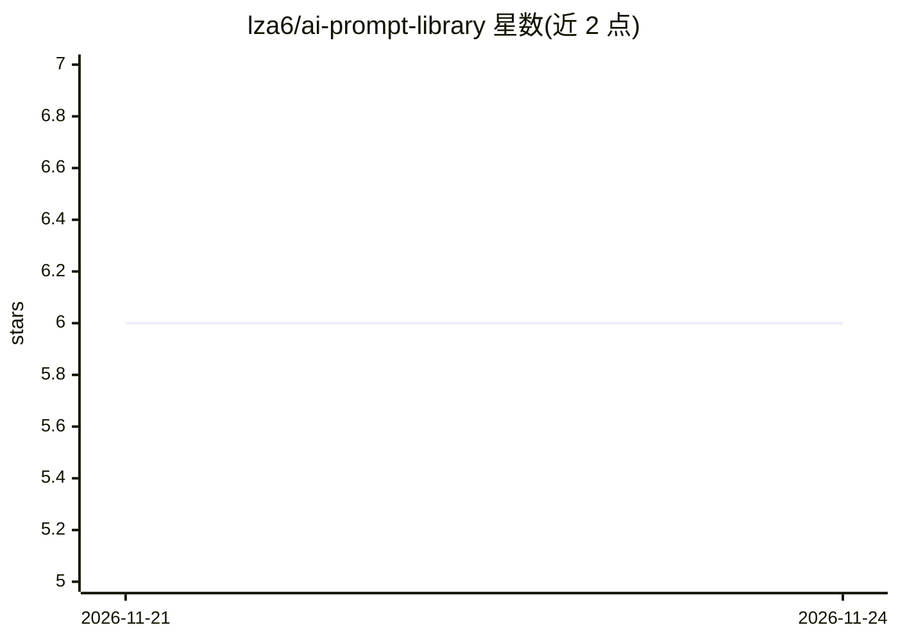

# lza6/ai-prompt-library

⭐ 6 · Python · 推送 2026-11-20 · [GitHub](https://github.com/lza6/ai-prompt-library) · 个人维护 · 中文 README

**面向 AI 使用者的中文提示词与技能聚合知识库**

收录 6922 个提示词/技能条目的静态知识库，按渗透测试、工作流、逆向方法论、UI 设计、营销、视频、产品、代码审查等分类组织，每技能一个目录与同名中文主文件，附属 references/scripts 同目录保留。技能来自约 50 个第三方开源项目，README 逐一列出上游来源与许可证；使用方式为直接复制粘贴给任意 LLM/Agent，无安装或运行步骤。

## 筛选速览

| 维度 | 判定 | 备注 |
|---|---|---|
| AI 角色 | `ai-knowledge` | 知识聚合/清单类 |
| 许可风险 | `none` | — |
| 部署形态 | `None` |  |
| 模型依赖 | — | README 未给出锁定关系 |
| 硬件要求 | — | 无带数字的原话,不猜 |
| 安装摩擦 | `medium` | 含编译或系统依赖之一 |
| 成熟度 | — | 结构信号不足 |

## 能力要点

- 总计 6922 个技能，按 16+ 分类目录组织
- 每个技能为独立目录 + 同名中文主文件，可直接粘贴使用
- 逐条列出约 50 个上游项目及对应开源许可证
- 含系统提示词泄露存档、越狱提示词等安全测试类内容

## 适用场景

- 查找可直接粘贴给 LLM/Agent 的领域提示词
- 汇集安全测试与逆向工程的技能模板
- 按分类检索全栈开发、SaaS 交付、UI/UX 等 SOP 提示词

## 场景标签

`提示工程` `网络安全` `代码审查` · 领域:Agent 开发

## 证据(README 行号)

> L3: 个人 AI 工作流提示词与技能知识库：覆盖全栈开发、代码审查、项目管理、交付验收、UI/UX、安全测试、逆向工程、文案、营销、视频、产品等全领域。每个技能一个目录、一篇与目录同名的中文提示词主文件（含英文原版 frontmatter
> L30: - 技能：进入 `分类/技能目录/技能名.md` 即该技能的完整提示词，可直接粘贴给任意 LLM / Agent 使用；同目录 `references/`、`scripts/` 为其附属资料。
> L26: 技能总计 6922 个；另有单文件提示词若干（`.txt` / `.md`）。

## 星数曲线

2026-11-21 6 → 2026-11-24 6（+0）

---
*卡片 v1 · prompt 1.4 · 生成 2026-11-21 · 置信度 high · 依据 README sha `144b4daaeda3` · [字段定义](../../DATASET.md)*
