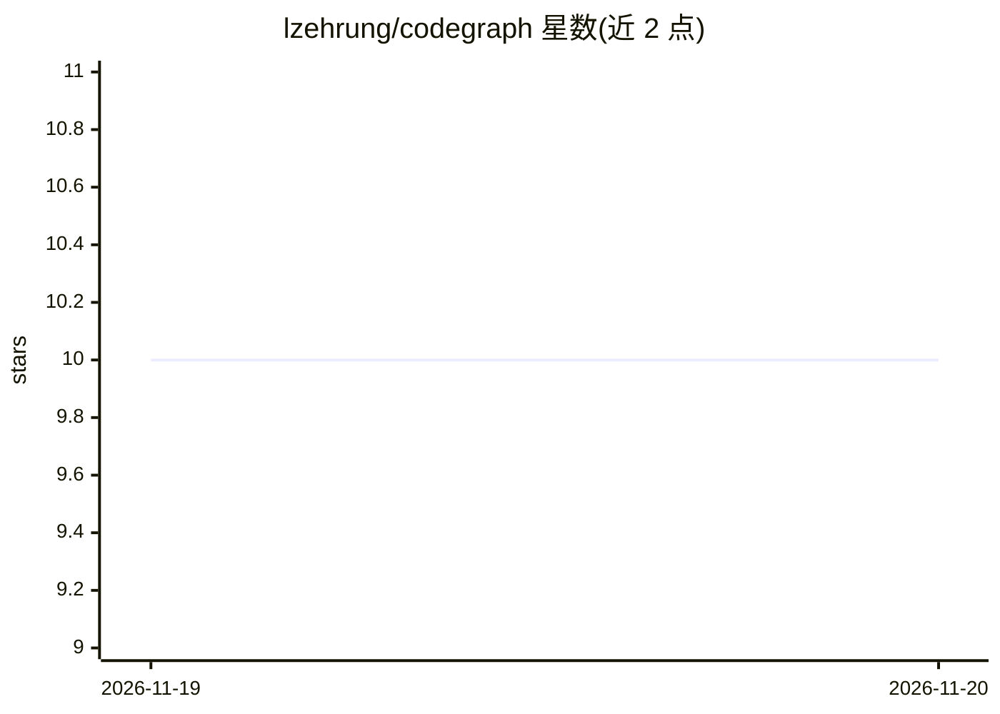

# lzehrung/codegraph

⭐ 10 · TypeScript · MIT · 推送 2026-11-19 · [GitHub](https://github.com/lzehrung/codegraph) · [官网](https://github.com/lzehrung/codegraph#readme) · 个人维护

**为编码 agent 提供代码库符号与依赖地图的本地工具**

本地运行的 CLI 与 TypeScript 库，用 tree-sitter 将源码树解析为文件、符号、引用与依赖的图谱，支持 explore/review/refs/rdeps/hotspots 等命令，输出带证据范围与省略计数的结构化结果。可导出 JSON/SQLite/Mermaid 图，并内置离线图形查看器。通过 MCP server 与安装器接入 codex、claude、cursor 等 agent 客户端，覆盖 14 种语言及 SQL、Terraform 等。需要 Node.js 22.16+，也可用独立安装器。

## 筛选速览

| 维度 | 判定 | 备注 |
|---|---|---|
| AI 角色 | `ai-ecosystem` | LLM/agent 周边工具 |
| 许可风险 | `permissive` | MIT |
| 部署形态 | `library` | 以包/库形式分发 |
| 模型依赖 | locked-api |  |
| 硬件要求 | — | 无带数字的原话,不猜 |
| 安装摩擦 | `low` | 无编译、无系统依赖或容器化 |
| 成熟度 | — | 结构信号不足 |

## 能力要点

- 基于 tree-sitter 的跨文件符号、引用与依赖解析，无法证明时返回 not_found 而非猜测
- 同一图谱复用于探索、影响分析、review 与候选测试选择
- MCP server 模式与 codegraph install 一键配置 8 类 agent 目标
- 支持 JSON/SQLite/Mermaid 导出与离线内置图查看器

## 适用场景

- 让编码 agent 不再花上下文轮次做目录探索
- review 变更可能影响的符号与应运行的测试
- 重构前查询符号引用与反向依赖
- 分析仓库热点文件与循环依赖

## 场景标签

`编码 Agent` `代码审查` · 领域:编码与开发

## 证据(README 行号)

> L12: **Give your coding agent a map of the repository, not a pile of search results.**
> L14: codegraph is a local CLI **and TypeScript library** that turns a source tree into a resolved map of files, symbols,
> L184: ## Agent setup

## 星数曲线

2026-11-19 10 → 2026-11-20 10（+0）

---
*卡片 v1 · prompt 1.4 · 生成 2026-11-19 · 置信度 high · 依据 README sha `2def1ab10aa3` · [字段定义](../../DATASET.md)*
