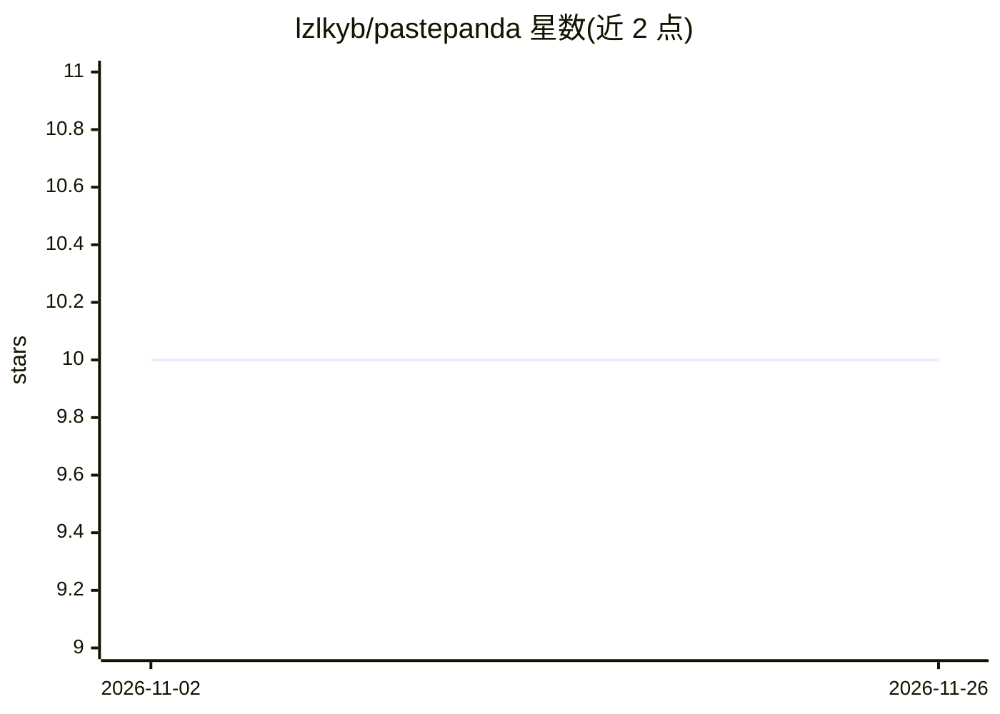

# lzlkyb/pastepanda

⭐ 10 · HTML · MIT · 推送 2026-11-23 · [GitHub](https://github.com/lzlkyb/pastepanda) · [官网](https://github.com/lzlkyb/pastepanda/wiki) · 个人维护 · 中文 README

**Windows 本地剪贴板管理器与个人知识库，AI 默认关闭**

基于 Tauri 2 + Rust 的 Windows 桌面工具，包含三块功能：剪贴板管理（历史记录、全局热键粘贴、粘贴栈模式、正则替换）；本地知识库（复制即转为笔记、全文检索、带引用角标的问答、MCP 服务暴露 18 个工具供外部 AI 使用、设备直连同步）；开发者工具箱（编解码、SQL 转换、日志统计、配置互转）。所有 AI 能力受 ai_enabled 开关门控，默认关闭时不发起外部请求；OCR 使用本地离线模型。通过 Releases 下载安装包运行。

## 筛选速览

| 维度 | 判定 | 备注 |
|---|---|---|
| AI 角色 | `ai-enhanced` | 去掉 AI 部分产品仍成立 |
| 许可风险 | `permissive` | MIT |
| 部署形态 | `desktop` | 安装包/桌面程序 |
| 模型依赖 | — | README 未给出锁定关系 |
| 硬件要求 | — | 无带数字的原话,不猜 |
| 安装摩擦 | `low` | 无编译、无系统依赖或容器化 |
| 成熟度 | — | 结构信号不足 |

## 能力要点

- 剪贴板历史、全局热键粘贴与粘贴栈模式
- 复制即沉淀的本地知识库，全文检索与带引用问答
- MCP 服务暴露 18 个工具，绑定 127.0.0.1 接入外部 AI
- 截图 OCR 走本地离线模型，AI 开关默认关闭

## 适用场景

- 集中管理并搜索我复制过的文本、图片和文件
- 把日常复制的内容沉淀成本地笔记并检索引用
- 用 MCP 让 Claude Code 等外部 AI 检索和写入我的笔记
- 编解码、SQL 拼接、日志统计等开发者转换操作

## 场景标签

`知识库管理` `OCR` · 领域:知识与检索

## 证据(README 行号)

> L3: > 🚀 一款基于 Tauri 2 的 Windows 桌面工具：管好剪贴板（历史 / 热键粘贴 / 栈模式），把复制过的东西沉淀成**本地知识库**（全文检索、带引用问答、MCP 接给 AI、多设备同步），另内置编解码 / SQL 
> L52: **AI 红线**：所有 AI 能力受 `ai_enabled` 门控（前后端双校验）。未开启时不会发起任何外部请求，
> L50: |🔒 **存储与隐私**|笔记全存本机 SQLite；截图 OCR 走本地离线模型（PP-OCRv6），全程不联网；AI 开关默认关闭，不开就是零请求、零上传|

## 星数曲线

2026-11-02 10 → 2026-11-26 10（+0）

---
*卡片 v1 · prompt 1.4 · 生成 2026-11-19 · 置信度 mid · 依据 README sha `f9aded0b64fd` · [字段定义](../../DATASET.md)*
