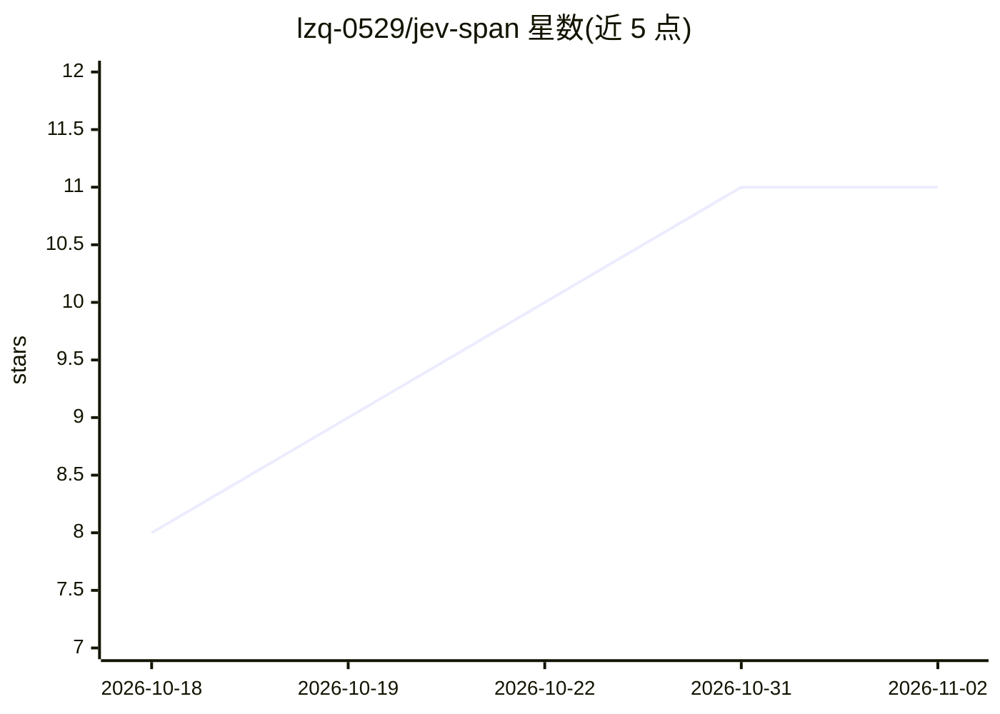

# lzq-0529/jev-span

⭐ 11 · Python · MIT · 推送 2026-09-28 · [GitHub](https://github.com/lzq-0529/jev-span) · 个人维护 · 中文 README

**零样本中英文命名实体识别 CLI/库，用自然语言定义实体类型**

基于 TypeSafe Jev API 的零样本 NER 工具：以 JSON schema 用一行描述定义任意实体类型，无需训练数据与 GPU。机制为切分文本、生成候选窗口交 Jev 选择题打分、验证与边界修正，每个实体附概率与可审计决策树。提供 pip 包、CLI、Python API 与本地 Web UI（中英界面），结果含缓存。限制：候选来自分段器，无窗口覆盖的实体无法识别，噪声文本上分数较低。12 个基准平均 73.7 strict F1。

## 筛选速览

| 维度 | 判定 | 备注 |
|---|---|---|
| AI 角色 | `ai-native` | 本体是模型或模型工具 |
| 许可风险 | `permissive` | MIT |
| 部署形态 | `library` | 以包/库形式分发 |
| 模型依赖 | — | README 未给出锁定关系 |
| 硬件要求 | — | 无带数字的原话,不猜 |
| 安装摩擦 | `low` | 无编译、无系统依赖或容器化 |
| 成熟度 | — | 结构信号不足 |

## 能力要点

- 实体类型以自然语言 JSON schema 定义，切换领域只需编辑文件
- 每个实体带校准概率，--trace 与 Web UI 输出完整决策树
- 中文优先分词：理解 CJK 标点、全角括号与书名号
- Jev 回答本地 SQLite 缓存，重复运行免费

## 适用场景

- 不训练模型直接抽取自定义类型实体（药品、产品型号、法律条款等）
- 审计实体抽取决策过程并按概率阈值过滤结果
- 复现 12 个中英文 NER 基准的零样本评测

## 场景标签

 · 领域:NLP/信息抽取

## 证据(README 行号)

> L3: **Zero-shot named entity recognition built on TypeSafe Jev.**
> L16: Jev answers typed multiple-choice questions with calibrated probabilities, but it never returns entity spans on its

## 星数曲线

2026-10-18 8 → 2026-11-02 11（+3）

---
*卡片 v1 · prompt 1.4 · 生成 2026-11-02 · 置信度 high · 依据 README sha `743f867e9015` · [字段定义](../../DATASET.md)*
