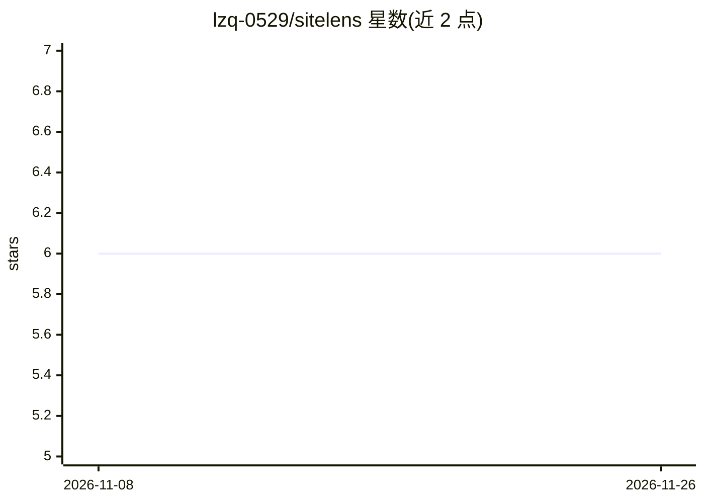

# lzq-0529/sitelens

⭐ 6 · Python · MIT · 推送 2026-11-04 · [GitHub](https://github.com/lzq-0529/sitelens) · 个人维护 · 中文 README

**独立站自托管运营监控台：流量、SEO、GEO 引用与转化**

面向独立电商卖家的自托管监控台，用 SQLite 存储、无公开注册。四块功能：流量总览（UV/PV、加购到支付漏斗、国内与国际分开统计）、SEO 爬虫日志（区分人类/搜索引擎/SEO 工具/AI 爬虫）、GEO 引用监测（每周 agent 从 API 拉取任务、向 15 个国内外问答引擎提交提示并回传答案做品牌提及评分）、已识别访客与已支付订单（tracker.js 埋点 + Shopify/WooCommerce webhook）。安装用 docker compose 或 Python venv + pip，前端需 npm 构建。

## 筛选速览

| 维度 | 判定 | 备注 |
|---|---|---|
| AI 角色 | `ai-enhanced` | 去掉 AI 部分产品仍成立 |
| 许可风险 | `permissive` | MIT |
| 部署形态 | `self-host` | docker 或自建部署 |
| 模型依赖 | — | README 未给出锁定关系 |
| 硬件要求 | — | 无带数字的原话,不猜 |
| 安装摩擦 | `low` | 无编译、无系统依赖或容器化 |
| 成熟度 | — | 结构信号不足 |

## 能力要点

- 监测 15 个问答引擎的品牌引用（GEO），由每周 agent 经 API 拉取任务并回传答案
- 爬虫分类：搜索引擎、SEO 工具与 AI 爬虫（GPTBot、Claude、DeepSeek 等）单独统计不混入人类 UV
- 访问→加购→结算→支付订单的电商漏斗，国内与国际主机分开计数
- 自托管 SQLite 存储，无公开注册，生产环境拒绝开放采集端点

## 适用场景

- 监控独立站在知乎/小红书/百度的流量来源与转化漏斗
- 查看 GPTBot、DeepSeek 等 AI 爬虫是否抓取了自己的店铺
- 每周检查各问答引擎是否推荐引用了自家店铺 URL

## 场景标签

`数据分析` · 领域:效率与自动化

## 证据(README 行号)

> L3: ### Self-hosted ops console for independent stores
> L5: **Traffic · SEO crawlers · Checkout conversion · GEO citations**
> L7: Shopify, WooCommerce, or a China + international pair. Your SQLite. No public signup. No marketing-cloud tax.
> L28:  GEO: AI citation watch across 15 answer engines 2. AI citation watch (GEO) — 15 answer engines, citations and bran
> L43: Google Analytics will tell you a session happened. Your Shopify admin will tell you an order happened. Search Conso

## 星数曲线

2026-11-08 6 → 2026-11-26 6（+0）

---
*卡片 v1 · prompt 1.4 · 生成 2026-11-20 · 置信度 high · 依据 README sha `9b3c71400b1f` · [字段定义](../../DATASET.md)*
