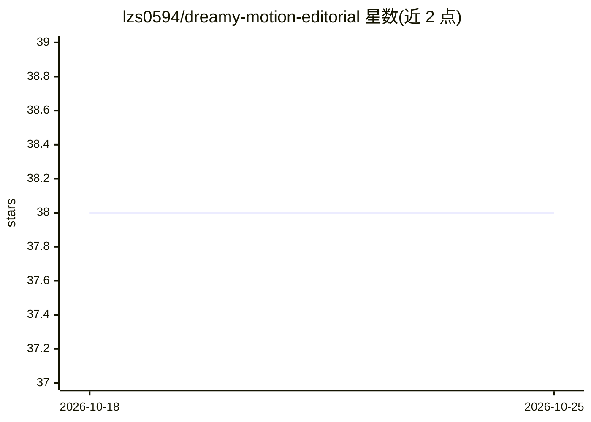

# lzs0594/dreamy-motion-editorial

⭐ 38 · Python · MIT · 推送 2026-08-09 · [GitHub](https://github.com/lzs0594/dreamy-motion-editorial) · 个人维护 · 中文 README

**面向 AI 图生图的照片分析提示词生成 Skill**

一个部署到 Codex/Claude 等 Agent 的视觉风格 Skill（SKILL.md 工作流）：读取用户照片，提取语义核心主体、动作、情绪与色彩，做 Keep/Fade/Remove 三层内容分层，基于慢门拖影、风动、逆光等物理运动机制构建动态留白，输出中英文图生图提示词、负面提示词、保真约束与参数建议。附 analyze_photo.py 脚本将照片特征转为结构化方向建议（支持 JSON 输出），并带单元测试。通过 git clone 复制到 Agent skills 目录安装。

## 筛选速览

| 维度 | 判定 | 备注 |
|---|---|---|
| AI 角色 | `ai-knowledge` | 知识聚合/清单类 |
| 许可风险 | `permissive` | MIT |
| 部署形态 | `None` |  |
| 模型依赖 | — | README 未给出锁定关系 |
| 硬件要求 | — | 无带数字的原话,不猜 |
| 安装摩擦 | `low` | 无编译、无系统依赖或容器化 |
| 成熟度 | — | 结构信号不足 |

## 能力要点

- Keep/Fade/Remove 三层内容分层决定画面保留与溶解
- 6 种风格机制（crowd-drift/glass-memory 等），每次限一个主机制
- analyze_photo.py 将照片特征转为方向建议，支持 JSON 输出
- 输出中英文提示词、负面提示词与保真约束

## 适用场景

- 把街拍或婚纱照转成朦胧梦幻风格的图生图提示词
- 通过对话让 Agent 分析照片并生成艺术写真方向提示词
- 批量处理旅行照生成杂志封面式视觉的生成参数

## 场景标签

`提示工程` `图像生成` · 领域:Agent 开发

## 证据(README 行号)

> L9: 这是一个面向 AI 图生图的**视觉风格分析与提示词生成 Skill**。
> L48: ├── SKILL.md                        # Skill 主文件与工作流

## 星数曲线

2026-10-18 38 → 2026-10-25 38（+0）

---
*卡片 v1 · prompt 1.4 · 生成 2026-10-25 · 置信度 high · 依据 README sha `42d6e1d4d5b1` · [字段定义](../../DATASET.md)*
