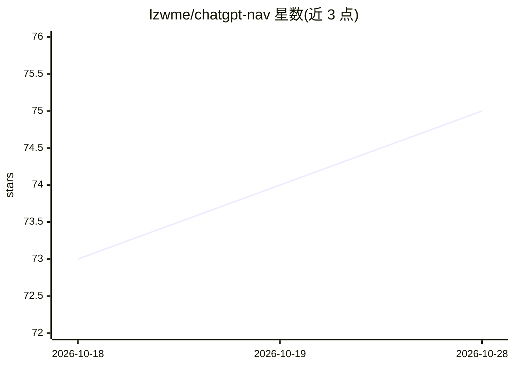

# lzwme/chatgpt-nav

⭐ 75 · TypeScript · MIT · 推送 2026-10-27 · [GitHub](https://github.com/lzwme/chatgpt-nav) · [官网](https://lzw.me/x/chatgpt-sites/) · 个人维护 · 中文 README

**AI 聊天与绘图在线工具网址导航清单（837 站）**

搜集整理当前流行可用的 AI 在线应用链接的导航清单仓库，收录 837 个站点，按国产大模型、AI 图像处理等分类组织。每个条目给出 URL、名称、一句简介与星级标记：星级反映免费、无需代理、无需 KEY 等条件；0 星表示可访问但功能受限或需私有密钥；另有需输入 API KEY 的标记。站点配置信息存放在 site-info.json，支持通过 PR 自荐收录。条目描述含大量推广性介绍文字，仅供索引参考。

## 筛选速览

| 维度 | 判定 | 备注 |
|---|---|---|
| AI 角色 | `ai-knowledge` | 知识聚合/清单类 |
| 许可风险 | `permissive` | MIT |
| 部署形态 | `None` |  |
| 模型依赖 | — | README 未给出锁定关系 |
| 硬件要求 | — | 无带数字的原话,不猜 |
| 安装摩擦 | `low` | 无编译、无系统依赖或容器化 |
| 成熟度 | — | 结构信号不足 |

## 能力要点

- 收录 837 个 AI 在线应用站点，分类组织
- 星级标记体系：免费/无需代理/无需 KEY 影响评级，0 星表示功能受限
- 站点配置通过 site-info.json 维护，支持自荐收录

## 适用场景

- 查找可用的 AI 聊天、绘图等在线工具入口
- 了解国产大模型及 AI 图像处理类站点的覆盖情况
- 为自己的 AI 应用提交自荐获取曝光

## 场景标签

`精选清单` · 领域:学习与行业

## 证据(README 行号)

> L1: # ChatGPT/AI 网站导航收集列表
> L3: 本仓库旨在搜集整理当前流行可用的 AI 在线应用列表，以供关注AI应用与发展的同学参考使用。
> L29: 站点列表(837)：

## 星数曲线

2026-10-18 73 → 2026-10-28 75（+2）

---
*卡片 v1 · prompt 1.4 · 生成 2026-10-24 · 置信度 high · 依据 README sha `921d56a27883` · [字段定义](../../DATASET.md)*
