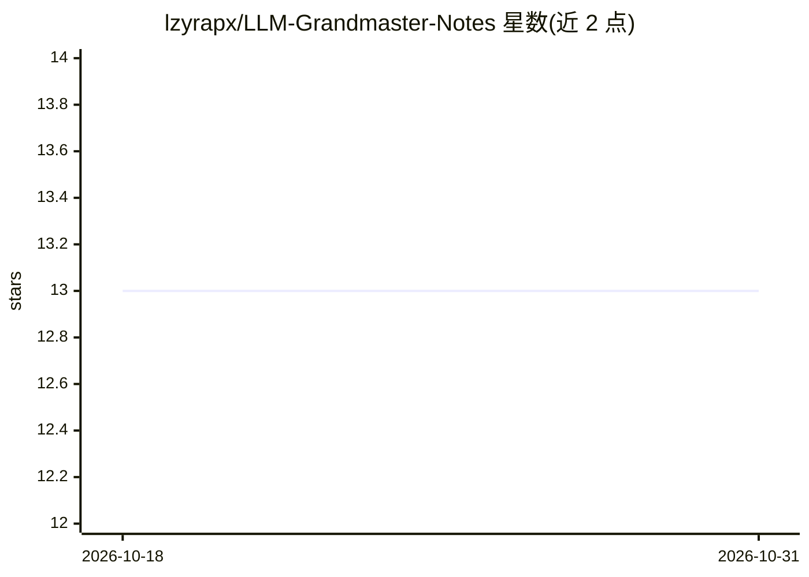

# lzyrapx/LLM-Grandmaster-Notes

⭐ 13 · Cuda · 推送 2026-07-16 · [GitHub](https://github.com/lzyrapx/LLM-Grandmaster-Notes) · 个人维护 · 中文 README

**LLM 底层技术的个人学习路线清单（中文笔记，CUDA/推理/RL）**

个人维护的 LLM 学习路线与笔记仓库，以复选框清单形式组织主题：Transformer 基础、GPU 架构（SM80-SM120）、Attention 变体（FlashAttention 系列、GQA/MLA 等）、量化、投机解码、CUDA/PTX 指令、GEMM（CUTLASS/cuBLAS）、分布式并行与 MoE、强化学习（PPO/GRPO/DPO 等）。已完成条目标记 [x]，未完成标记 [ ]，README 自述为中文笔记（CHINESE NOTES）。无安装运行说明，属知识清单而非可运行软件。

## 筛选速览

| 维度 | 判定 | 备注 |
|---|---|---|
| AI 角色 | `ai-knowledge` | 知识聚合/清单类 |
| 许可风险 | `none` | — |
| 部署形态 | `None` |  |
| 模型依赖 | — | README 未给出锁定关系 |
| 硬件要求 | — | 无带数字的原话,不猜 |
| 安装摩擦 | `medium` | 含编译或系统依赖之一 |
| 成熟度 | — | 结构信号不足 |

## 能力要点

- 覆盖 Attention/量化/投机解码/分布式并行/MoE 等约 15 类主题的学习清单
- 包含 CUDA/PTX 指令（mbarrier、wgmma、TMA 等）与 GEMM 调度内容
- 复选框标记已完成 [x] 与待完成 [ ] 条目

## 适用场景

- 按清单系统学习 LLM 推理与训练底层技术
- 了解 CUDA 编程与 GPU 架构相关主题范围
- 跟踪自己在大模型底层技术上的学习进度

## 场景标签

`精选清单` · 领域:学习与行业

## 证据(README 行号)

> L1: # LLM Grandmaster Notes
> L5: - base

## 星数曲线

2026-10-18 13 → 2026-10-31 13（+0）

---
*卡片 v1 · prompt 1.4 · 生成 2026-10-31 · 置信度 high · 依据 README sha `ef59a70e3d2e` · [字段定义](../../DATASET.md)*
