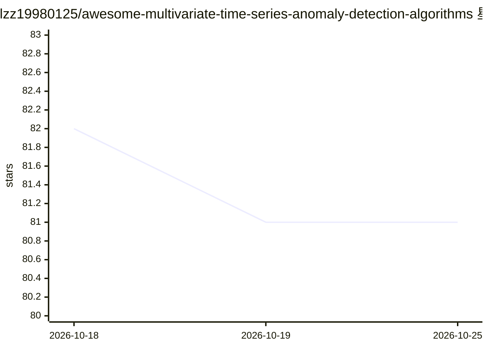

# lzz19980125/awesome-multivariate-time-series-anomaly-detection-algorithms

⭐ 81 · 推送 2026-08-04 · [GitHub](https://github.com/lzz19980125/awesome-multivariate-time-series-anomaly-detection-algorithms) · 个人维护

**多变量时间序列异常检测论文阅读清单**

收录多变量时间序列异常检测领域论文的 awesome 类阅读清单，按年份（2024-2026）与发表会议/期刊（KDD、VLDB、ICDE、NeurIPS、AAAI、IEEE 系列等）以表格组织，条目含论文标题与开源代码链接（部分为 None）。README 请求引用维护者相关论文（含 Neurocomputing、IEEE Sensors Journal 等）。仓库声明仍在持续改进中，不提供软件安装或运行方式。

## 筛选速览

| 维度 | 判定 | 备注 |
|---|---|---|
| AI 角色 | `ai-knowledge` | 知识聚合/清单类 |
| 许可风险 | `none` | — |
| 部署形态 | `None` |  |
| 模型依赖 | — | README 未给出锁定关系 |
| 硬件要求 | — | 无带数字的原话,不猜 |
| 安装摩擦 | `low` | 无编译、无系统依赖或容器化 |
| 成熟度 | — | 结构信号不足 |

## 能力要点

- 按年份与会议/期刊分类的论文表格（覆盖 2024-2026）
- 部分条目附开源代码仓库名
- 涉及 KDD/VLDB/ICDE/NeurIPS/IEEE 多刊物约百篇条目

## 适用场景

- 查找多变量时间序列异常检测的近期论文与对应代码
- 按会议/期刊浏览该领域研究脉络
- 为科研选题做文献调研

## 场景标签

`精选清单` · 领域:学习与行业

## 证据(README 行号)

> L1: # Awesome Multivariate Time Series anomaly detection Papers
> L5: This repository contains a reading list of papers on **multivariate time series anomaly detection**. **This reposito

## 星数曲线

2026-10-18 82 → 2026-10-25 81（-1）

---
*卡片 v1 · prompt 1.4 · 生成 2026-10-24 · 置信度 high · 依据 README sha `cc1f52ab1288` · [字段定义](../../DATASET.md)*
