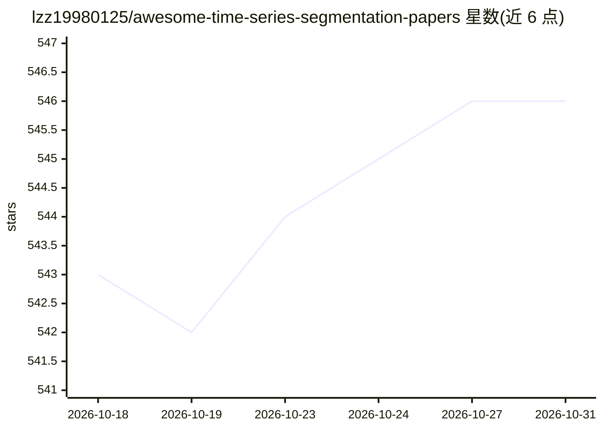

# lzz19980125/awesome-time-series-segmentation-papers

⭐ 546 · MATLAB · GPL-3.0 · 推送 2026-10-07 · [GitHub](https://github.com/lzz19980125/awesome-time-series-segmentation-papers) · 个人维护

**时间序列分割论文阅读清单（按研究团队索引）**

面向科研读者的时间序列分割（time series segmentation）论文阅读清单。收录范围除分割本身外，还纳入变点检测、异常检测、信息论相关方法，以及计算机视觉与普适计算领域的动作捕捉分割论文。条目按知名研究者/研究团队（Stanford、UC Riverside、NUS、Virginia Tech 等）组织，附发表 venue、代码链接与个人推荐标记（🌟）。README 说明该领域约 95% 收录工作为无监督方法，并指出领域缺少带真值标注的大型公开数据集。仓库自述仍在持续完善中。

## 筛选速览

| 维度 | 判定 | 备注 |
|---|---|---|
| AI 角色 | `ai-knowledge` | 知识聚合/清单类 |
| 许可风险 | `viral` | GPL-3.0 |
| 部署形态 | `None` |  |
| 模型依赖 | — | README 未给出锁定关系 |
| 硬件要求 | — | 无带数字的原话,不猜 |
| 安装摩擦 | `low` | 无编译、无系统依赖或容器化 |
| 成熟度 | — | 结构信号不足 |

## 能力要点

- 按研究者/研究团队（Stanford、UC Riverside、NUS、Virginia Tech 等）索引论文条目
- 收录范围覆盖分割、变点检测、异常检测与动作捕捉分割
- 条目附 venue、代码链接与推荐标记（🌟）
- 作者指出所收工作约 95% 为无监督方法

## 适用场景

- 调研时间序列分割领域的经典与近期论文
- 按研究团队追踪该方向的代表工作与代码实现
- 寻找变点检测相关的评测与综述入口

## 场景标签

`精选清单` `科研工具` · 领域:学习与行业

## 证据(README 行号)

> L8: This repository contains a reading list of papers on **Time Series Segmentation**. **This repository is still being 
> L12: Time series segmentation often intertwines with research in many domains. Firstly, the relationship between **time 
> L20: In the field of time series research, unlike time series forecasting, anomaly detection, and classification/cluster

## 星数曲线

2026-10-18 543 → 2026-10-31 546（+3）

---
*卡片 v1 · prompt 1.4 · 生成 2026-10-21 · 置信度 high · 依据 README sha `578f9f157528` · [字段定义](../../DATASET.md)*
