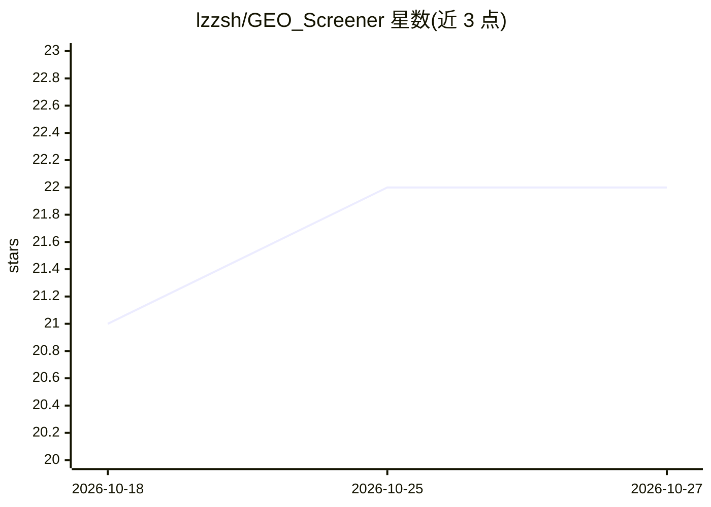

# lzzsh/GEO_Screener

⭐ 22 · Python · MIT · 推送 2026-09-14 · [GitHub](https://github.com/lzzsh/GEO_Screener) · 个人维护 · 中文 README

**面向 NCBI GEO 数据集筛选与实验方案提取的自托管研究工作台**

自托管的生物信息研究工作区：按关键词/登录号搜索 GEO 或导入 CSV，用自然语言纳入标准对候选数据集做筛选，对 GSE/GSM 记录做标注并保存人工修正；从关联文献中提取结构化实验方案（处理事件、剂量、时间窗），附页面证据与人工修订历史，可导出筛选 CSV、方案 TSV 与证据 JSON。模型通过 OrcaRouter（推荐）或 DeepSeek 等 OpenAI 兼容连接接入。支持本地 Python 3.11 运行与 Docker 部署（含 Celery/Redis），界面中英双语。

## 筛选速览

| 维度 | 判定 | 备注 |
|---|---|---|
| AI 角色 | `ai-native` | 本体是模型或模型工具 |
| 许可风险 | `permissive` | MIT |
| 部署形态 | `library` | 以包/库形式分发 |
| 模型依赖 | — | README 未给出锁定关系 |
| 硬件要求 | — | 无带数字的原话,不猜 |
| 安装摩擦 | `low` | 无编译、无系统依赖或容器化 |
| 成熟度 | — | 结构信号不足 |

## 能力要点

- 自然语言纳入标准的 GEO 数据集筛选与人工修正
- 从文献/补充材料提取结构化实验方案，附页面证据与修订历史
- 导出筛选 CSV、方案 TSV、证据/问题 JSON
- OrcaRouter 推荐接入，兼容 DeepSeek 等 OpenAI 兼容模型连接

## 适用场景

- 按纳入/排除标准批量筛选 GEO 数据集并留档理由
- 为筛选中的研究提取并人工审校实验处理方案（剂量/时间窗/分组）
- 导出带来源证据的结构化方案供后续分析

## 场景标签

`科研工具` · 领域:学习与行业

## 证据(README 行号)

> L11: GEO Screener is a self-hosted research workspace for finding GEO datasets, screening them against your criteria, an
> L24: |Models|OrcaRouter is listed first and marked **Recommended**; DeepSeek and other OpenAI-compatible connections rem

## 星数曲线

2026-10-18 21 → 2026-10-27 22（+1）

---
*卡片 v1 · prompt 1.4 · 生成 2026-10-27 · 置信度 high · 依据 README sha `e663df4b376e` · [字段定义](../../DATASET.md)*
