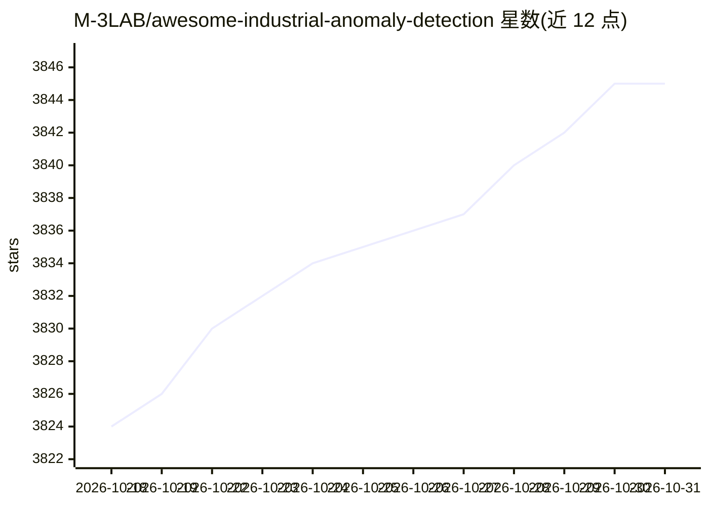

# M-3LAB/awesome-industrial-anomaly-detection

⭐ 3,845 · 推送 2026-10-23 · [GitHub](https://github.com/M-3LAB/awesome-industrial-anomaly-detection) · [官网](https://link.springer.com/content/pdf/10.1007/s11633-023-1459-z.pdf) · 组织维护 · 中文 README

**工业图像异常/瑕疵检测论文与数据集的策展清单（持续更新）**

M-3LAB 维护的 awesome 型论文清单，收录工业图像异常检测与缺陷检测领域的论文、代码与公开数据集，按 SOTA 方法（Teacher-Student、重建、少样本、零样本、噪声、持续学习、多类统一等主题）、推荐基准（Anomalib、IM-IAD、MMAD 等）与会议（ECCV/ICML 2026 等）组织条目，条目附 arXiv/GitHub 链接。同时关联同团队的综述论文、异常合成基准 ASBench、3D 异常检测清单及 AD-Copilot 模型项目，README 以条目列举为主，不含本仓库安装运行内容。

## 筛选速览

| 维度 | 判定 | 备注 |
|---|---|---|
| AI 角色 | `ai-knowledge` | 知识聚合/清单类 |
| 许可风险 | `none` | — |
| 部署形态 | `None` |  |
| 模型依赖 | — | README 未给出锁定关系 |
| 硬件要求 | — | 无带数字的原话,不猜 |
| 安装摩擦 | `low` | 无编译、无系统依赖或容器化 |
| 成熟度 | — | 结构信号不足 |

## 能力要点

- 按主题分类的 SOTA 方法清单，条目附论文与代码链接
- 收录 Anomalib、IM-IAD、MMAD 等推荐基准
- 覆盖 ECCV 2026、ICML 2026 等近期会议条目
- 关联 ASBench 异常合成基准与 3D 异常检测子清单

## 适用场景

- 查找工业缺陷检测的 SOTA 方法与开源实现
- 选择异常检测评测用的公开数据集与基准
- 跟踪该领域近期会议论文动态

## 场景标签

`精选清单` · 领域:学习与行业

## 证据(README 行号)

> L3: We discuss public datasets and related studies in detail. Welcome to read our paper and make comments.
> L33: |Title|Venue|Date|Code|topic|
> L65: # Recommended Benchmarks

## 星数曲线

2026-10-18 3,824 → 2026-10-31 3,845（+21）

---
*卡片 v1 · prompt 1.4 · 生成 2026-10-20 · 置信度 high · 依据 README sha `6d23947b3170` · [字段定义](../../DATASET.md)*
