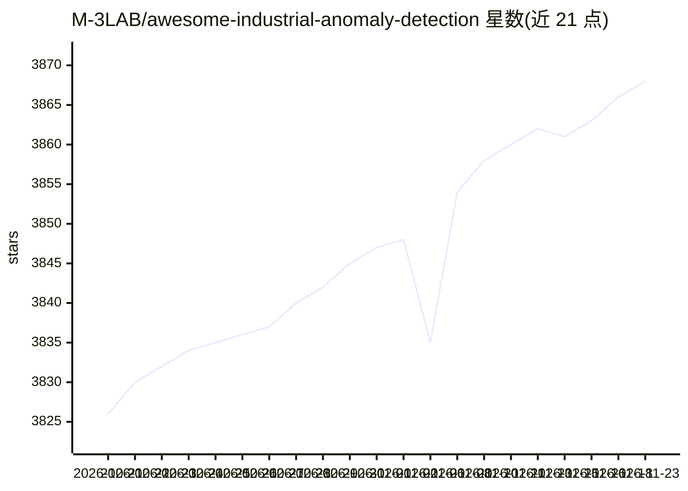

# M-3LAB/awesome-industrial-anomaly-detection

⭐ 3,868 · 推送 2026-11-05 · [GitHub](https://github.com/M-3LAB/awesome-industrial-anomaly-detection) · [官网](https://link.springer.com/content/pdf/10.1007/s11633-023-1459-z.pdf) · 组织维护 · 中文 README

**工业图像异常检测的论文与数据集检索清单**

以清单形式整理工业图像异常/瑕疵检测领域的论文、数据集与基准：按 SOTA 方法（教师-学生、重建、少样本、多类统一、零样本等主题）、推荐基准、近期会议论文（NeurIPS/ECCV 2026 等）分节组织，多数条目附论文与代码链接。维护团队同期发布综述论文、IM-IAD 基准（open-iad）、MMAD 多模态大模型评测基准及 AD-Copilot 等衍生项目，并持续更新。面向该领域研究者做文献检索与选型。

## 筛选速览

| 维度 | 判定 | 备注 |
|---|---|---|
| AI 角色 | `ai-knowledge` | 知识聚合/清单类 |
| 许可风险 | `none` | — |
| 部署形态 | `None` |  |
| 模型依赖 | — | README 未给出锁定关系 |
| 硬件要求 | — | 无带数字的原话,不猜 |
| 安装摩擦 | `low` | 无编译、无系统依赖或容器化 |
| 成熟度 | — | 结构信号不足 |

## 能力要点

- SOTA 方法清单按 Teacher-Student、Reconstruction、Few-Shot 等主题标注
- 推荐基准一节收录 Anomalib、IM-IAD、ADer、MMAD 等
- 收录数据集条目并持续更新（3D、点云、多模态、逻辑异常等方向）
- 关联团队发布的综述、IM-IAD 基准与 AD-Copilot/MMAD 项目

## 适用场景

- 做工业缺陷检测研究时查找相关论文与代码
- 为异常检测实验挑选公开数据集与基准
- 了解零样本、少样本、多类统一等方向的最新进展

## 场景标签

`科研工具` `精选清单` · 领域:学习与行业

## 证据(README 行号)

> L1: # Awesome Industrial Anomaly Detection Awesome
> L13: Keywords: anomaly detection, anomaly segmentation, industrial image, defect detection
> L31: # SOTA methods with code

## 星数曲线

2026-10-21 3,826 → 2026-11-23 3,868（+42）

---
*卡片 v1 · prompt 1.4 · 生成 2026-11-23 · 置信度 high · 依据 README sha `c4a4c0a4e391` · [字段定义](../../DATASET.md)*
