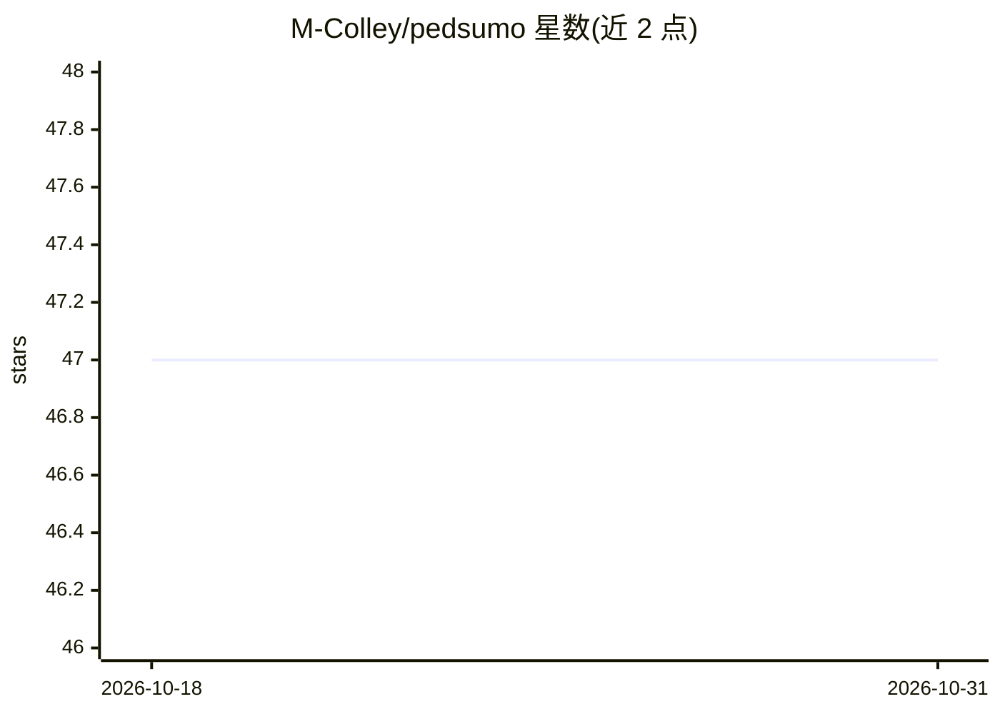

# M-Colley/pedsumo

⭐ 47 · HTML · MIT · 推送 2026-09-13 · [GitHub](https://github.com/M-Colley/pedsumo) · 组织维护

**科研用交通仿真库：模拟自动驾驶车与行人过街交互**

基于 SUMO（需 1.21.0+）扩展的 Python 仿真项目，研究自动驾驶车辆（AV）与行人在无优先权过街处的交互：为行人加入年龄、性别、视力等属性与可调的‘违抗值’，影响其无视 AV 优先权过街的概率，并在仿真后输出统计结果。提供配置 GUI、仿真监控 GUI 与命令行循环批量仿真，内置 7 个改编场景（Ingolstadt、Ulm、Monaco 等）。可选启用 LLM（flan-alpaca-large，经 Transformers 加载）推导过街决策，标注为高度实验性且需 CUDA 显卡。附 HRI'24 短文 DOI 与可复现的种子机制。

## 筛选速览

| 维度 | 判定 | 备注 |
|---|---|---|
| AI 角色 | `ai-enhanced` | 去掉 AI 部分产品仍成立 |
| 许可风险 | `permissive` | MIT |
| 部署形态 | `library` | 以包/库形式分发 |
| 模型依赖 | — | README 未给出锁定关系 |
| 硬件要求 | — | 无带数字的原话,不猜 |
| 安装摩擦 | `medium` | 含编译或系统依赖之一 |
| 成熟度 | `idea` | |

## 能力要点

- 行人的 AV 优先权无视行为建模（年龄/性别/视力属性与可调违抗值）
- 7 个改编 SUMO 场景（Small_Test、Ingolstadt、Ulm、Monaco、Bologna、Wildau、Manhattan）
- 配置 GUI、数据可视化 GUI 与命令行批量循环仿真
- 可选 LLM（flan-alpaca-large）推导过街决策，需 CUDA，标注高度实验性

## 适用场景

- 研究 AV 密度与 eHMI 对交通流和行人行为的影响
- 批量参数扫描式仿真并导出 CSV 结果
- 用不同随机种子做独立重复实验以计算置信区间

## 场景标签

`科研工具` · 领域:学习与行业

## 证据(README 行号)

> L23: This project concerns the effects of automated vehicles (AVs) in traffic and how their interaction with pedestrians
> L66: - Usage of LLMs to derive a crossing decision: We currently use flan-alpaca-large but recommend flan-alpaca-gpt4-xl

## 星数曲线

2026-10-18 47 → 2026-10-31 47（+0）

---
*卡片 v1 · prompt 1.4 · 生成 2026-10-25 · 置信度 mid · 依据 README sha `3d8d77677743` · [字段定义](../../DATASET.md)*
