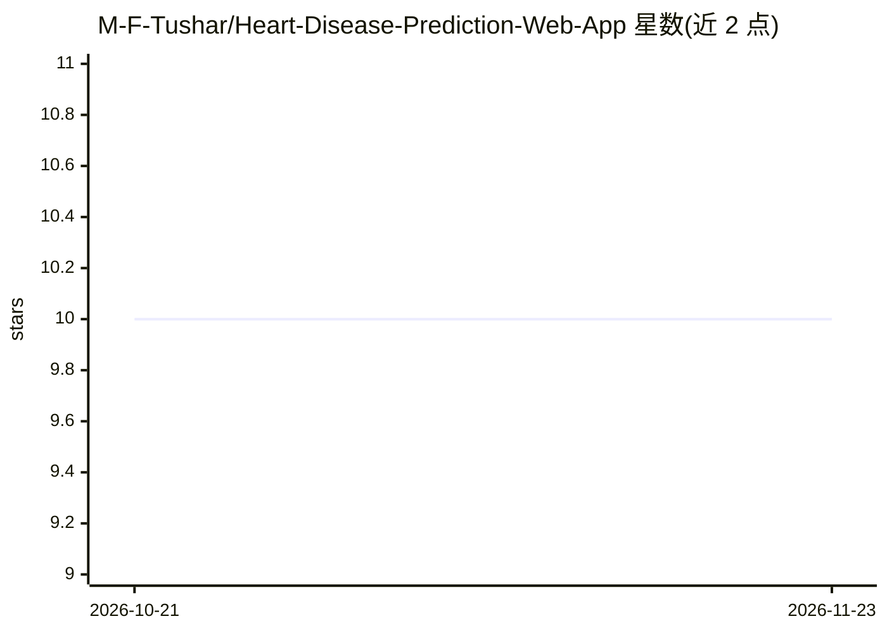

# M-F-Tushar/Heart-Disease-Prediction-Web-App

⭐ 10 · Jupyter Notebook · MIT · 推送 2026-01-26 · [GitHub](https://github.com/M-F-Tushar/Heart-Disease-Prediction-Web-App) · [官网](https://m-f-tushar-heart-disease-prediction-web-app-app-hwx2ii.streamlit.app/) · 个人维护

**基于机器学习的心脏病风险预测 Web 应用**

使用 Streamlit 构建的网页应用，用户输入 13 项医疗属性后，由 Logistic Regression 模型（在 UCI Heart Disease 数据集 303 名患者样本上训练，测试准确率约 85%）输出心脏病风险预测及概率分数。提供实时预测、输入校验、交互式表单提示，模型缺失时自动创建。README 附带医疗免责声明：仅供教育用途，非诊断工具。支持本地运行及部署到 Streamlit Community Cloud。

## 筛选速览

| 维度 | 判定 | 备注 |
|---|---|---|
| AI 角色 | `ai-native` | 本体是模型或模型工具 |
| 许可风险 | `permissive` | MIT |
| 部署形态 | `library` | 以包/库形式分发 |
| 模型依赖 | — | README 未给出锁定关系 |
| 硬件要求 | — | 无带数字的原话,不猜 |
| 安装摩擦 | `low` | 无编译、无系统依赖或容器化 |
| 成熟度 | — | 结构信号不足 |

## 能力要点

- Logistic Regression 模型基于 UCI Heart Disease 数据集（303 样本、13 特征）
- 输入患者信息后实时输出风险预测与概率分数
- 模型文件缺失时自动创建
- 提供输入校验与医疗免责声明

## 适用场景

- 输入患者医疗信息，查看心脏病风险评估概率
- 学习如何用 Streamlit 与 scikit-learn 构建预测类 Web 应用
- 教学场景下演示机器学习预测流程

## 场景标签

 · 领域:医疗健康/机器学习应用

## 证据(README 行号)

> L8: A web application that predicts heart disease risk using machine learning. Built with Streamlit and scikit-learn.
> L11: This app uses a machine learning model trained on real patient data to estimate the risk of heart disease. Enter pa

## 星数曲线

2026-10-21 10 → 2026-11-23 10（+0）

---
*卡片 v1 · prompt 1.4 · 生成 2026-11-20 · 置信度 high · 依据 README sha `e0b250c74ed7` · [字段定义](../../DATASET.md)*
