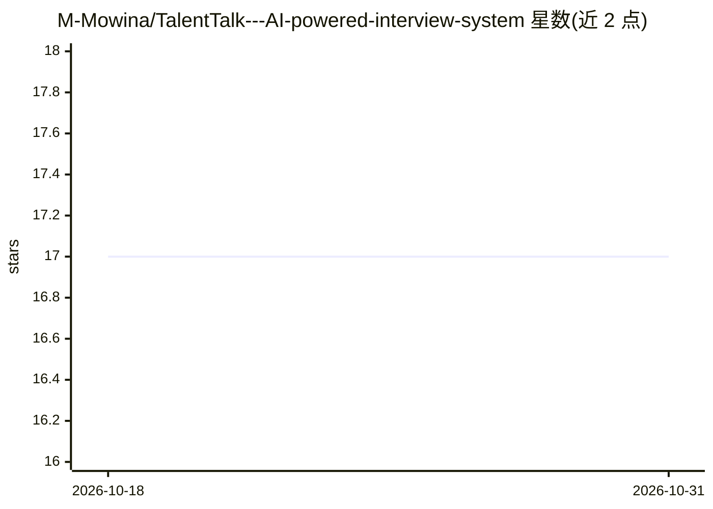

# M-Mowina/TalentTalk---AI-powered-interview-system

⭐ 17 · Jupyter Notebook · 推送 2026-05-14 · [GitHub](https://github.com/M-Mowina/TalentTalk---AI-powered-interview-system) · [官网](https://talenttalk---ai-powered-interview-system-mhjch3tpnrw7v8hem9z7s.streamlit.app/) · 个人维护

**AI 技术面试系统：动态简历分析、语音交互、自动评估报告**

面向招聘/HR 场景的 AI 面试系统：基于 LangGraph 多阶段工作流执行技术面试，支持文本与语音两种模式；上传简历后进行向量分析生成个性化问题，可配置面试官风格、岗位、公司、题量与追问数。语音方面提供本地 Whisper 与云端 AssemblyAI 两种语音转文字选项，用 ElevenLabs 生成语音回复；面试结束后由 LLM 评估候选人回答并生成 HR 报告，可导出 PDF。以 Python/Streamlit 源码形式提供，需配置 AssemblyAI、ElevenLabs、Google Generative AI 等 API key。

## 筛选速览

| 维度 | 判定 | 备注 |
|---|---|---|
| AI 角色 | `ai-native` | 本体是模型或模型工具 |
| 许可风险 | `none` | — |
| 部署形态 | `library` | 以包/库形式分发 |
| 模型依赖 | — | README 未给出锁定关系 |
| 硬件要求 | — | 无带数字的原话,不猜 |
| 安装摩擦 | `low` | 无编译、无系统依赖或容器化 |
| 成熟度 | — | 结构信号不足 |

## 能力要点

- 文本与语音两种面试模式，语音转文字可选本地 Whisper 或云端 AssemblyAI
- 简历上传后经向量分析生成个性化问题，支持追问
- 面试官风格/岗位/公司/题量等可配置
- 自动评估回答并生成 HR 报告，支持 PDF 导出

## 适用场景

- 用 AI 自动进行技术面试并生成评估报告
- 基于候选人简历生成个性化面试问题
- 以语音方式远程完成面试流程

## 场景标签

 · 领域:HR/招聘自动化

## 证据(README 行号)

> L3: An AI-powered interview system that conducts technical interviews, evaluates responses, and generates comprehensive 
> L21: - **LangGraph Workflow**: Multi-stage interview process with evaluation and reporting
> L89: - **Google Generative AI**: For the LLM powering the interview

## 星数曲线

2026-10-18 17 → 2026-10-31 17（+0）

---
*卡片 v1 · prompt 1.4 · 生成 2026-10-30 · 置信度 mid · 依据 README sha `cb83114eb211` · [字段定义](../../DATASET.md)*
