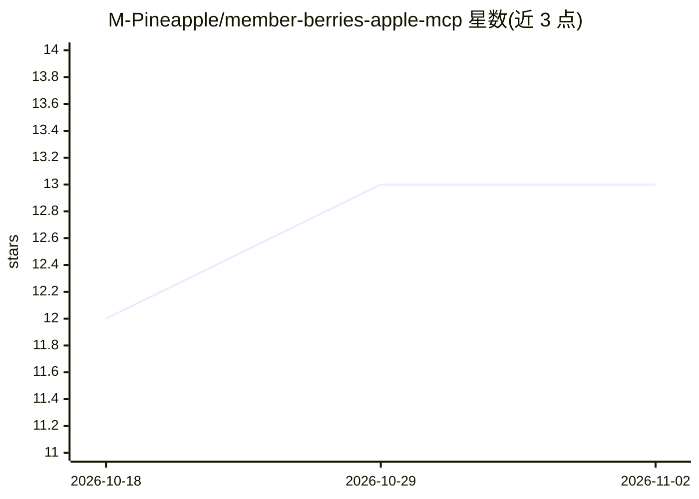

# M-Pineapple/member-berries-apple-mcp

⭐ 13 · TypeScript · MIT · 推送 2026-11-01 · [GitHub](https://github.com/M-Pineapple/member-berries-apple-mcp) · [官网](https://glama.ai/mcp/servers/M-Pineapple/member-berries-apple-mcp) · 个人维护

**让 MCP 客户端读写 Apple 日历/备忘录/提醒事项的 macOS MCP 服务器**

apple-mcp 的个性化分支，以 TypeScript 编写的 MCP 服务器，通过 macOS 自动化把 Apple Calendar、Notes、Reminders 接入 Claude、ChatGPT、Cursor 等任意 MCP 客户端，提供 briefing 一次性日总结及日历/备忘录/提醒事项的搜索、列表、创建等工具，并附带本地对话记忆层，数据存于本地 ~/.member-berries-memory.json（mode 600），无云同步。仅限 macOS 使用（Linux/Windows 可安装但工具会失败）。支持 Bun 源码运行或 npm 全局安装，MIT 许可。

## 筛选速览

| 维度 | 判定 | 备注 |
|---|---|---|
| AI 角色 | `ai-ecosystem` | LLM/agent 周边工具 |
| 许可风险 | `permissive` | MIT |
| 部署形态 | `library` | 以包/库形式分发 |
| 模型依赖 | — | README 未给出锁定关系 |
| 硬件要求 | — | 无带数字的原话,不猜 |
| 安装摩擦 | `low` | 无编译、无系统依赖或容器化 |
| 成熟度 | — | 结构信号不足 |

## 能力要点

- briefing/today 一次性输出日历、到期提醒与备忘录标题的日总结
- Calendar/Notes/Reminders 的搜索、列表、创建、完成、删除等 MCP 工具
- 本地记忆文件 ~/.member-berries-memory.json（mode 600），无云同步
- 兼容任意 MCP 客户端（Claude Desktop、ChatGPT、Cursor、Claude Code 等）

## 适用场景

- 用自然语言让 AI 助手查询今天日程、创建提醒或搜索备忘录
- 让 AI 助手记住并跟进已完成的日程（如牙医预约）
- 在数据不出本机的前提下把 Apple 三件套接入 AI 客户端

## 场景标签

 · 领域:MCP 工具服务器/Apple 生态集成

## 证据(README 行号)

> L8: Your AI assistant (Claude, ChatGPT, Cursor or any MCP client) gets local memory of Calendar, Notes and Reminders — s
> L25: > **macOS only.** Member Berries drives Apple Calendar, Reminders and Notes through macOS automation, so its tools 
> L60:  Claude Desktop example (same `bun run …/index.ts` command works in ChatGPT, Cursor, Claude Code or any other MCP h

## 星数曲线

2026-10-18 12 → 2026-11-02 13（+1）

---
*卡片 v1 · prompt 1.4 · 生成 2026-10-31 · 置信度 high · 依据 README sha `bb1b3c8e4378` · [字段定义](../../DATASET.md)*
