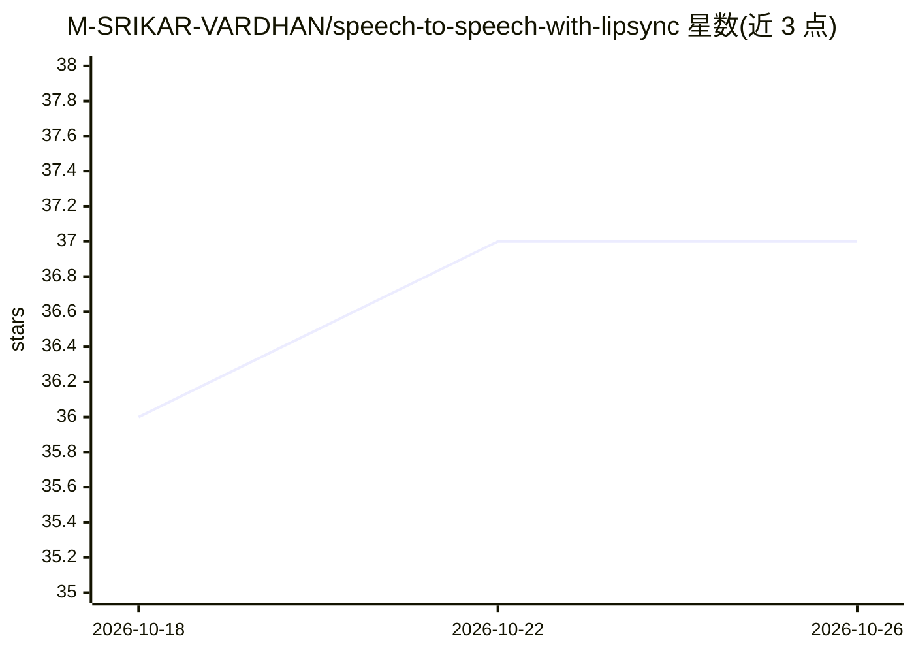

# M-SRIKAR-VARDHAN/speech-to-speech-with-lipsync

⭐ 37 · Python · 推送 2026-03-24 · [GitHub](https://github.com/M-SRIKAR-VARDHAN/speech-to-speech-with-lipsync) · 个人维护

**英语视频转泰卢固语配音的端到端管线：ASR+NMT+TTS+RVC+Wav2Lip**

由个人开发者构建的多阶段语音到语音翻译管线：Whisper 转录英语视频、NLLB 翻译为目标语言文本、MMS-TTS 合成语音、RVC 用约 15 分钟说话人样本将合成语音转换回原说话人音色、Wav2Lip 对口型后输出配音视频。模型权重需另行下载放入对应目录，默认 480p 分辨率 CPU 可跑，1080p 需 GPU；可替换模型支持其他目标语言并重训 RVC。以源码形式提供，含完整管线与仅对口型的单独运行方式。

## 筛选速览

| 维度 | 判定 | 备注 |
|---|---|---|
| AI 角色 | `ai-native` | 本体是模型或模型工具 |
| 许可风险 | `none` | — |
| 部署形态 | `library` | 以包/库形式分发 |
| 模型依赖 | — | README 未给出锁定关系 |
| 硬件要求 | — | 无带数字的原话,不猜 |
| 安装摩擦 | `low` | 无编译、无系统依赖或容器化 |
| 成熟度 | — | 结构信号不足 |

## 能力要点

- 五阶段管线：Whisper ASR → NLLB NMT → MMS-TTS → RVC 音色转换 → Wav2Lip 对口型
- RVC 用约 15 分钟语音训练即可保留原说话人音色，语言无关
- 默认 480p CPU 友好，可提升至 1080p（需 GPU）
- lip.py 支持已有配音视频的单独对口型

## 适用场景

- 把英语演讲或视频自动配音成泰卢固语等其他语言
- 制作保留原说话人音色的多语言版本视频
- 对已有配音视频单独做口型同步

## 场景标签

 · 领域:语音/视频翻译

## 证据(README 行号)

> L28: |**1. Transcription**|🗣️ **Whisper ASR**|Video with English Speech|`English Text`|
> L31: |**4. Voice Conversion**|🧬 **RVC**|`Generic Audio` + `Speaker's Voice Sample`|`Telugu Audio (Original Voice)`|

## 星数曲线

2026-10-18 36 → 2026-10-26 37（+1）

---
*卡片 v1 · prompt 1.4 · 生成 2026-10-25 · 置信度 high · 依据 README sha `3b8030661504` · [字段定义](../../DATASET.md)*
