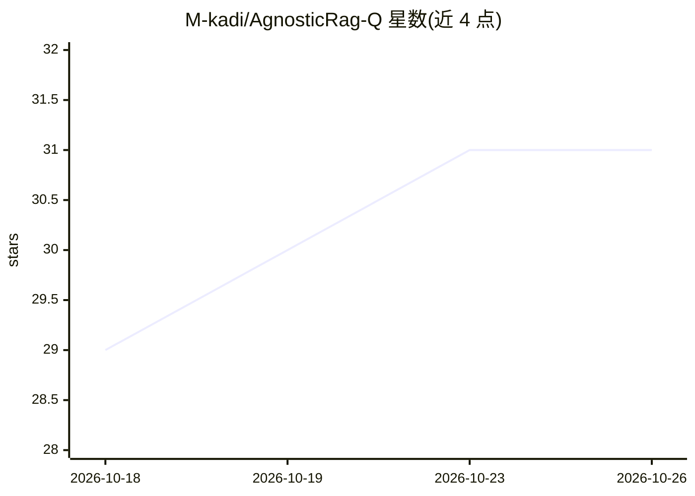

# M-kadi/AgnosticRag-Q

⭐ 31 · 推送 2026-09-14 · [GitHub](https://github.com/M-kadi/AgnosticRag-Q) · 个人维护

**云无关的多模态 RAG/GraphRAG/Text-to-SQL 平台，面向企业 AI 应用构建**

基于 FastAPI 的 Agentic AI 平台，组合 Qdrant 向量检索、BM25 混合搜索、Neo4j 知识图谱，支持 PDF/表格/图片/音频/OCR 等多模态摄取与检索（ColQwen/ColPali 多向量、Whisper+CLAP 音频）。AgnosticRagRouter 按 LLM 路由查询至多个 RAG 后端并合并结果；RagSQL 用 GraphRAG 缩减大库 schema 后生成 SQL 并经 SQLGlot 校验；AgnosticRagMCP 通过 MCP 接入 Odoo、PostgreSQL、Telegram、Teams 等企业服务。LLM 提供方（OpenAI/Gemini/Ollama/本地模型）经配置切换，提供 Docker 模块化部署、Web Chatbot 与桌面 GUI。给构建企业搜索、知识库问答与自然语言数据库应用的开发者使用。

## 筛选速览

| 维度 | 判定 | 备注 |
|---|---|---|
| AI 角色 | `ai-ecosystem` | LLM/agent 周边工具 |
| 许可风险 | `none` | — |
| 部署形态 | `self-host` | docker 或自建部署 |
| 模型依赖 | local-ok | 支持本地模型 |
| 硬件要求 | — | 无带数字的原话,不猜 |
| 安装摩擦 | `low` | 无编译、无系统依赖或容器化 |
| 成熟度 | — | 结构信号不足 |

## 能力要点

- LLM 路由的 AgnosticRagRouter 多后端编排与结果合并
- GraphRAG（Qdrant+Neo4j）含多跳推理与多种查询策略
- RagSQL 大库 schema 检索 + SQLGlot 校验的自然语言查库
- MCP 企业集成（Odoo/PostgreSQL/Telegram/Teams 等）与可插拔 LLM 提供方

## 适用场景

- 搭建企业私有文档与知识图谱的多模态搜索
- 用自然语言查询大型 PostgreSQL 数据库
- 把 RAG 能力接入 Telegram/Teams/Odoo 等企业渠道与系统

## 场景标签

`RAG` `数据分析` · 领域:效率与自动化

## 证据(README 行号)

> L3: **AgnosticRag-Q** is a cloud-agnostic and LLM-agnostic **Agentic AI, RAG, GraphRAG & RagSQL platform** for building 
> L192: - Directly as a FastAPI backend
> L194: - As a foundation for custom enterprise applications

## 星数曲线

2026-10-18 29 → 2026-10-26 31（+2）

---
*卡片 v1 · prompt 1.4 · 生成 2026-10-26 · 置信度 high · 依据 README sha `18c920d65a22` · [字段定义](../../DATASET.md)*
