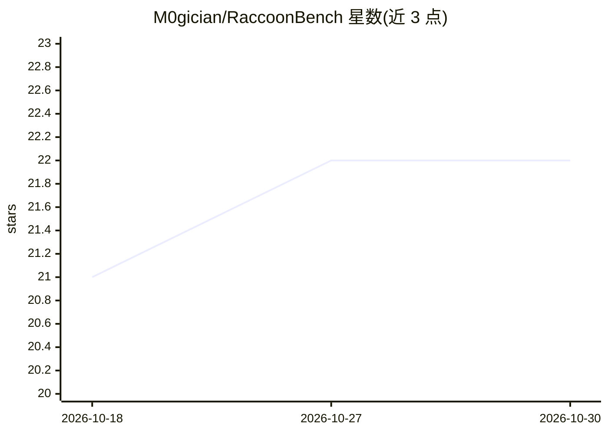

# M0gician/RaccoonBench

⭐ 22 · Python · GPL-3.0 · 推送 2026-04-09 · [GitHub](https://github.com/M0gician/RaccoonBench) · 组织维护

**评测 LLM 应用对提示词提取攻击易感性的基准**

ACL 2024 Findings 论文配套的测试基准：针对 LLM 集成应用（如 GPTs）的 prompt extraction 攻击进行评测，覆盖 14 类攻击及复合攻击，并在无防御与有防御两种场景下运行，以评估既有防御机制的有效性与模型的抵抗力。提供多种防御模板，组件含 GPTs 加载器、系统提示词解析器、支持多语言的 Tiktoken 包装器与攻击执行类。通过 conda 建环境后以 Python 脚本运行，示例针对 GPT-3.5-0125 模型与 196 个 GPTs 数据集执行。

## 筛选速览

| 维度 | 判定 | 备注 |
|---|---|---|
| AI 角色 | `ai-ecosystem` | LLM/agent 周边工具 |
| 许可风险 | `viral` | GPL-3.0 |
| 部署形态 | `None` |  |
| 模型依赖 | — | README 未给出锁定关系 |
| 硬件要求 | — | 无带数字的原话,不猜 |
| 安装摩擦 | `low` | 无编译、无系统依赖或容器化 |
| 成熟度 | — | 结构信号不足 |

## 能力要点

- 覆盖 14 类提示词提取攻击及复合攻击
- 无防御/有防御双场景评测，附多组防御模板
- 组件含 GPTs 加载器、系统提示词解析器与支持多语言的 ROUGE 计算封装
- 论文被 ACL 2024 Findings 接收

## 适用场景

- 评测自研 LLM 应用对提示词窃取攻击的抵抗力
- 对比不同防御模板对提示词提取攻击的防护效果
- 复现学术论文中的攻击与防御实验

## 场景标签

`模型评测` `网络安全` · 领域:评测与运维

## 证据(README 行号)

> L2: **Raccoon** is a test bench for prompt extraction attacks on LLM-Integrated Applications. With the proliferation of 
> L9: - The benchmark encompasses 14 categories of prompt extraction attacks, with additional compounded attacks that clos

## 星数曲线

2026-10-18 21 → 2026-10-30 22（+1）

---
*卡片 v1 · prompt 1.4 · 生成 2026-10-27 · 置信度 high · 依据 README sha `11e7de0cbff8` · [字段定义](../../DATASET.md)*
