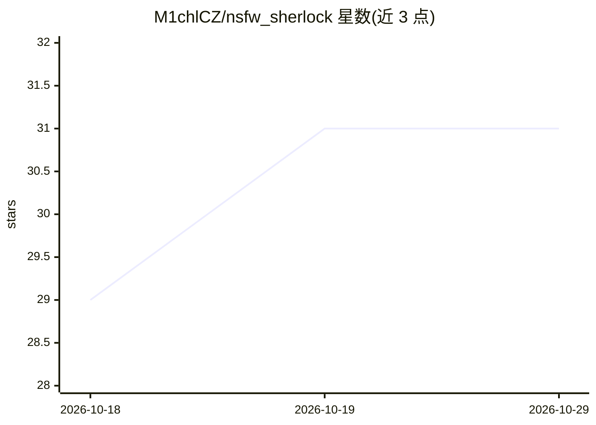

# M1chlCZ/nsfw_sherlock

⭐ 31 · Go · AGPL-3.0 · 推送 2026-10-27 · [GitHub](https://github.com/M1chlCZ/nsfw_sherlock) · 个人维护

**自托管 NSFW 图片/视频内容审核 API 服务**

用 Go 编写的自托管图像审核 API：单个二进制文件通过 ONNX Runtime 运行照片/动漫分类与显式区域检测模型，对图片与采样视频帧输出 nsfw/sfw 判定、五类标签概率与区域检测结果；提供 HTTP 与 gRPC 两种接口、批量检查、缓存和可选的 Tesseract OCR 文字检测。面向需要在自己的服务器上做内容审核、避免订阅或按图计费的开发者。支持 Docker 一键启动（Linux amd64/arm64）与 CUDA/ROCm/TensorRT/OpenVINO 执行 provider（README 声明 GPU provider 未在物理硬件上测试）；源码构建默认不含 OCR。

## 筛选速览

| 维度 | 判定 | 备注 |
|---|---|---|
| AI 角色 | `ai-native` | 本体是模型或模型工具 |
| 许可风险 | `dual` | AGPL-3.0 |
| 部署形态 | `desktop` | 安装包/桌面程序 |
| 模型依赖 | local-ok | 支持本地模型 |
| 硬件要求 | — | 无带数字的原话,不猜 |
| 安装摩擦 | `low` | 无编译、无系统依赖或容器化 |
| 成熟度 | — | 结构信号不足 |

## 能力要点

- 单 Go 二进制通过 ONNX Runtime 运行照片/动漫分类与区域检测模型
- HTTP 与 gRPC 双接口，含批量检查与相同图片缓存
- 视频审核：按 FPS 采样帧分析并返回最差判定（需 ffmpeg）
- 可选 Tesseract OCR 检测图片中的违规文字

## 适用场景

- 在自己的服务器上审核用户上传图片，避免外部 API 费用
- 对视频采样帧做 NSFW 扫描获得整体判定
- 通过 HTTP/gRPC 将图像审核集成进现有应用

## 场景标签

`目标检测` · 领域:感知与多模态

## 证据(README 行号)

> L10: NSFW Sherlock is a free, open-source API that checks images for NSFW content on your own hardware.
> L15: - **Image checks:** Classify photos and anime, and detect explicit regions.
> L68: |`POST /pic/analyze`|Full analysis, model scores, region detections, and elapsed time|

## 星数曲线

2026-10-18 29 → 2026-10-29 31（+2）

---
*卡片 v1 · prompt 1.4 · 生成 2026-10-27 · 置信度 high · 依据 README sha `f9d83f710bd1` · [字段定义](../../DATASET.md)*
