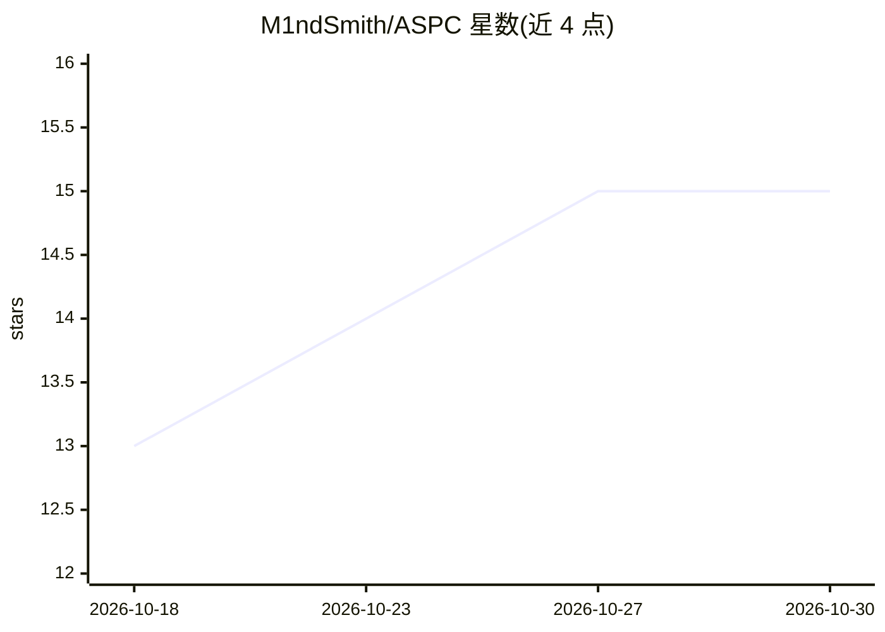

# M1ndSmith/ASPC

⭐ 15 · Python · MIT · 推送 2026-08-17 · [GitHub](https://github.com/M1ndSmith/ASPC) · [官网](https://aspc-web.vercel.app/) · 个人维护

**AI 驱动的制造业 SPC/MSA/过程能力分析平台**

面向制造业质量工程的统计过程控制系统：提供 Shewhart（I-MR、Xbar-R/S、P/NP/C/U）与 EWMA/CUSUM 控制图、MSA（Gage R&R、偏倚、线性、稳定性）、Cp/Cpk 能力分析；采用 Phase I 建立并冻结版本化限值、Phase II 实时判定新数据的两阶段流程。架构为六边形模块化单体（纯统计核 spc_core、FastAPI+CLI、Next.js 看板），支持 TimescaleDB、Redpanda/MQTT 流式实时监控与 WebSocket 告警。描述称支持英文自然语言提问生成图表报告。限制：公式保真不等于 Minitab/JMP 一致性；MSA 与 valid_range 门控为可选项。

## 筛选速览

| 维度 | 判定 | 备注 |
|---|---|---|
| AI 角色 | `ai-enhanced` | 去掉 AI 部分产品仍成立 |
| 许可风险 | `permissive` | MIT |
| 部署形态 | `self-host` | docker 或自建部署 |
| 模型依赖 | — | README 未给出锁定关系 |
| 硬件要求 | — | 无带数字的原话,不猜 |
| 安装摩擦 | `low` | 无编译、无系统依赖或容器化 |
| 成熟度 | — | 结构信号不足 |

## 能力要点

- Phase I 建立并冻结版本化限值、Phase II 按冻结限值实时判定的门控流程（含 10 项 go-live 检查清单）
- 9 类控制图 + Gage R&R/偏倚/线性/稳定性 MSA + 参数/变换/非参数能力分析路由
- 实时流式栈：Redpanda、Mosquitto、TimescaleDB、Redis、stream-engine、MQTT bridge，Docker Compose 一键部署
- FastAPI + CLI 双入口，JWT/API-key 认证，WebSocket 实时告警与 SSE 回放

## 适用场景

- 按 Phase I→冻结→Phase II 流程建立并监控生产控制限
- 对测量系统做 Gage R&R 与偏倚/线性/稳定性分析
- 冲压/制药/注塑等产线接入 Kafka/MQTT 数据流做实时 SPC
- 生成能力指数与 DPMO/西格玛水平报告

## 场景标签

`数据分析` · 领域:效率与自动化

## 证据(README 行号)

> L3: Correct, tested SPC for **batch** and **real-time** work: Shewhart / EWMA / CUSUM charts, MSA, capability, Timescale
> L18: Reproduce benches: `python benchmarks/performance.py` and `python benchmarks/accuracy.py` (benchmarks/README.md). C

## 星数曲线

2026-10-18 13 → 2026-10-30 15（+2）

---
*卡片 v1 · prompt 1.4 · 生成 2026-10-30 · 置信度 low · 依据 README sha `0ebf4934ef40` · [字段定义](../../DATASET.md)*
