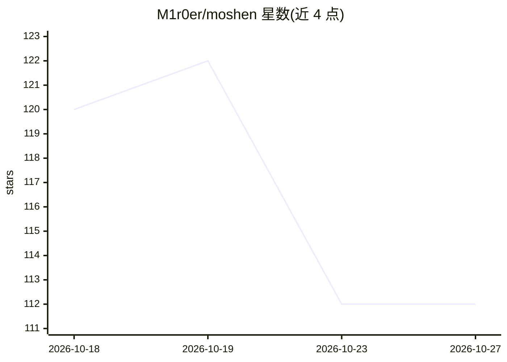

# M1r0er/moshen

⭐ 112 · JavaScript · MIT · 推送 2026-10-13 · [GitHub](https://github.com/M1r0er/moshen) · 个人维护 · 中文 README

**本地优先的个人写作 Agent：整理资料、核对设定、追踪伏笔，不代写正文**

面向长篇小说作者的 Electron 桌面应用，把模型放在编辑位置：自动读稿件、审稿（设定一致性、OOC、逻辑、节奏、文风）、单章与全文伏笔检测回收、星图实体关系抽取（增量更新）、角色阶段拆分与观察收件箱、知识库整理。正文仅由作者在写作页手动保存写入，AI 写入分约定标记直接写入与待确认提案两类，均标来源且不覆盖手工内容。使用任意 OpenAI 兼容接口按职能分配模型，Key 自配；数据存本地工作区。限制：不生成正文，当前仅提供 Windows 构建。

## 筛选速览

| 维度 | 判定 | 备注 |
|---|---|---|
| AI 角色 | `ai-native` | 本体是模型或模型工具 |
| 许可风险 | `permissive` | MIT |
| 部署形态 | `desktop` | 安装包/桌面程序 |
| 模型依赖 | local-ok | 支持本地模型 |
| 硬件要求 | — | 无带数字的原话,不猜 |
| 安装摩擦 | `low` | 无编译、无系统依赖或容器化 |
| 成熟度 | — | 结构信号不足 |

## 能力要点

- AI 审稿输出设定一致性/OOC/逻辑/节奏/文风/伏笔问题清单，保存后自动巡检
- 星图从稿件抽取六类实体与关系，3D 关系图可视化，增量更新不覆盖手动内容
- 多职能模型分配（TEXT_MASTER 等 6 角色）+ 意图路由 + 降级链
- 本地文件存储、原子写入，AI 写入需确认且带 author/ai 来源标注

## 适用场景

- 管理长篇小说的设定、大纲、角色与伏笔台账，保持前后一致
- 让 AI 审稿指出人物 OOC、逻辑因果与文风问题，再由我自己修改
- 从稿件与参考资料抽取实体关系，构建 3D 星图档案库

## 场景标签

`AI 写作` `知识图谱` `知识库管理` · 领域:内容生成

## 证据(README 行号)

> L3: **本地优先的个人写作 Agent：自己整理资料、自己核对设定、自己追踪伏笔，把模型放在编辑的位置，不代你动笔**
> L80: |对话|讨论大纲、人物、设定、伏笔与逻辑；流式输出；输入意图自动路由到合适的职能模型；发现问题时给出 L1 建议 / L2 质询 / L3 否决；可提出待确认提案，由你点「加入」或「忽略」后归入设定、大纲、知识库或爽爆点；单条回复
> L397: - 当前只提供 Windows 构建。

## 星数曲线

2026-10-18 120 → 2026-10-27 112（-8）

---
*卡片 v1 · prompt 1.4 · 生成 2026-10-23 · 置信度 high · 依据 README sha `f2d8788d7afa` · [字段定义](../../DATASET.md)*
