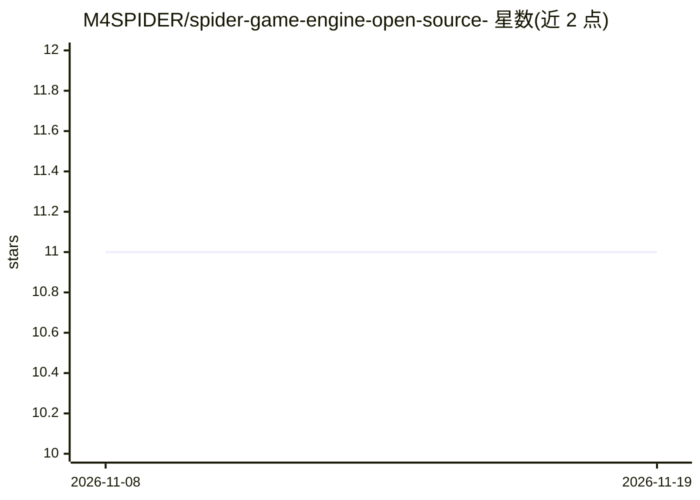

# M4SPIDER/spider-game-engine-open-source-

⭐ 11 · JavaScript · NOASSERTION · 推送 2026-11-05 · [GitHub](https://github.com/M4SPIDER/spider-game-engine-open-source-) · [官网](https://game.m4spider.com) · 个人维护

**AI 原生 3D 游戏引擎：Agent 实时生成、构建并测试游戏**

基于 React Three Fiber、Three.js 与 WebGL 的自主 Agent 式 3D 游戏引擎与仿真环境，支持 Web、Electron 与 Tauri 多平台运行。通过 MCP（Model Context Protocol）接入多模态 AI 模型（Llama 3.3/3.1 405B/3.2 Vision、Meta Muse），实时合成、挂载、验证并运行 3D 游戏与交互仿真。内置 MCP 服务器提供画面检查、截图与 3D 视口验证的自主闭环；含 RAG 上下文保持、JSX 到 C++20/SPY 转译、Blender MCP 桥与内置 Spider Store 游戏市场。仓库为 hackathon 里程碑版本（v0.9.0）。

## 筛选速览

| 维度 | 判定 | 备注 |
|---|---|---|
| AI 角色 | `ai-native` | 本体是模型或模型工具 |
| 许可风险 | `none` | NOASSERTION |
| 部署形态 | `desktop` | 安装包/桌面程序 |
| 模型依赖 | local-ok | 支持本地模型 |
| 硬件要求 | — | 无带数字的原话,不猜 |
| 安装摩擦 | `medium` | 含编译或系统依赖之一 |
| 成熟度 | `idea` | |

## 能力要点

- 内置 MCP 服务器（localhost:9287）支持自主游戏生成与 3D 视口验证
- Meta Llama 3.3/3.1 405B/3.2 Vision 与 Muse Voice ASR，经 Groq、OpenRouter 或本地 Ollama 推理
- React Three Fiber JSX 场景图转译为 C++20 与 SPY 脚本，可导出至 UE5/Godot/Unity
- Web/Electron/Tauri 多平台，浏览器与移动端零安装运行

## 适用场景

- 通过自然语言对话让 Agent 实时生成可玩的 3D 游戏
- 在移动浏览器上零安装创建与游玩 3D 世界
- 把生成的 JSX 场景转译为 C++/SPY 部署到其他引擎

## 场景标签

 · 领域:游戏开发/AI 原生引擎

## 证据(README 行号)

> L14: **Spider Game Engine** is an autonomous, agentic 3D game engine and simulation environment built on React, Three.js
> L16: It integrates directly with multimodal AI models (including Muse AI) over MCP (Model Context Protocol) to synthesiz
> L49: - **Autonomous Agentic Loop**: Built-in MCP server (`http://localhost:9287/mcp`) supporting live inspection, screen

## 星数曲线

2026-11-08 11 → 2026-11-19 11（+0）

---
*卡片 v1 · prompt 1.4 · 生成 2026-11-19 · 置信度 mid · 依据 README sha `1dc54290a3d2` · [字段定义](../../DATASET.md)*
