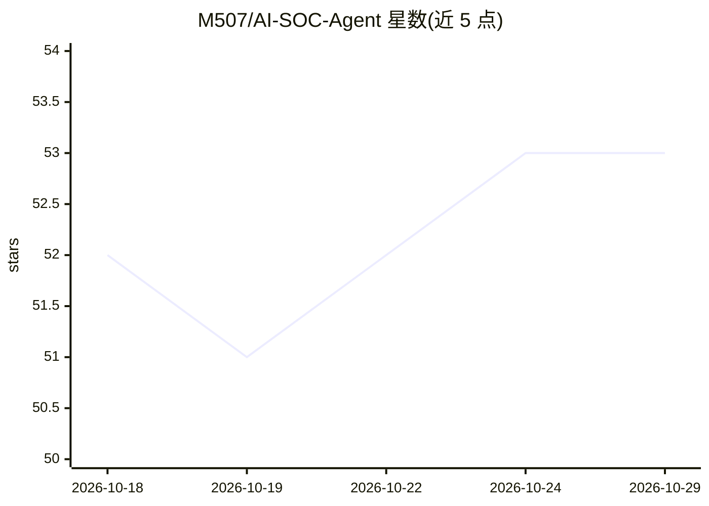

# M507/AI-SOC-Agent

⭐ 53 · Python · MIT · 推送 2026-09-30 · [GitHub](https://github.com/M507/AI-SOC-Agent) · 个人维护

**面向 SOC 团队的 AI 安全调查与事件响应平台（MCP server）**

Blackhat 2025 议题配套项目 SamiGPT：以 MCP server 形式将安全调查与响应能力（告警分诊、案件管理、SIEM 检索、EDR 隔离、CTI 富化、NetBox 资产查询）暴露为工具，供 AI agent、LLM 工具与自动化工作流调用；集成 TheHive/IRIS、Elastic、OpenCTI 等平台，采用厂商中立通用接口。内置 SOC1/SOC2 分层 agent 角色与 runbook，提供 Web 控制台、配置向导、审计视图与报告视图。安装支持 Docker Compose（onboarding 栈）与 systemd 生产服务两种方式，官方推荐经 Open WebUI 接入任意 LLM 提供方。项目自述处于活跃开发中，接口与文档可能变更。

## 筛选速览

| 维度 | 判定 | 备注 |
|---|---|---|
| AI 角色 | `ai-ecosystem` | LLM/agent 周边工具 |
| 许可风险 | `permissive` | MIT |
| 部署形态 | `self-host` | docker 或自建部署 |
| 模型依赖 | — | README 未给出锁定关系 |
| 硬件要求 | — | 无带数字的原话,不猜 |
| 安装摩擦 | `low` | 无编译、无系统依赖或容器化 |
| 成熟度 | `idea` | |

## 能力要点

- MCP server 将安全调查/响应工具暴露给 AI agent 与 LLM 工具调用
- 集成 TheHive/IRIS、Elastic SIEM、EDR、OpenCTI、NetBox，厂商中立通用接口
- SOC1（分诊）/SOC2（深入调查）分层 agent 角色与 runbook
- Docker Compose 引导栈与 systemd 生产服务双安装路径，浏览器配置向导

## 适用场景

- 安全运营团队自动化告警分诊与误报识别
- SOC2 深度调查中跨 SIEM/EDR/CTI 的关联分析
- 通过 Open WebUI 等客户端驱动安全事件响应工作流
- 将安全工具接入 AI agent 生态作为 MCP 工具集

## 场景标签

`网络安全` · 领域:学习与行业

## 证据(README 行号)

> L3: **SamiGPT** is an AI-powered security investigation and incident response platform that provides security operations
> L162: The **official, supported way** to use SamiGPT's tools is to connect them to

## 星数曲线

2026-10-18 52 → 2026-10-29 53（+1）

---
*卡片 v1 · prompt 1.4 · 生成 2026-10-24 · 置信度 high · 依据 README sha `ec8f29860f52` · [字段定义](../../DATASET.md)*
