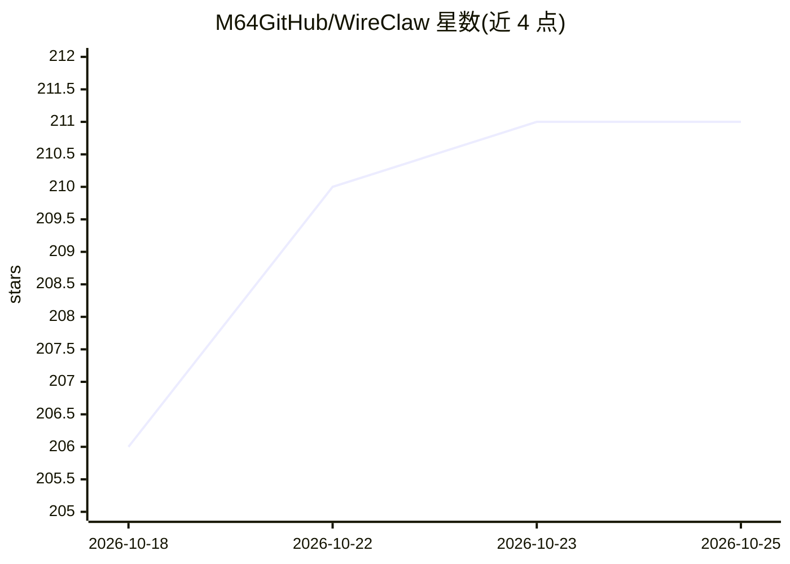

# M64GitHub/WireClaw

⭐ 211 · C++ · 推送 2026-02-23 · [GitHub](https://github.com/M64GitHub/WireClaw) · [官网](https://wireclaw.io) · 个人维护

**运行在 ESP32 上的本地 AI agent：对话配置硬件与离线自动化规则**

面向 ESP32-C6/S3/C3（需 4MB flash）的固件：通过 Telegram、串口或 NATS 用自然语言对话，由 LLM（OpenRouter 或 Ollama/llama.cpp 等本地服务器）产生工具调用，配置 GPIO、传感器、继电器和自动化规则；规则持久化到 flash，由主循环在无网络、无 LLM 的条件下 7x24 运行。支持持久记忆、NTP 时间规则、串口桥接外部设备、NATS 虚拟传感器与多设备组网，提供浏览器 Web Flasher 与 Web 配置门户，也可用 PlatformIO 手动构建。

## 筛选速览

| 维度 | 判定 | 备注 |
|---|---|---|
| AI 角色 | `ai-native` | 本体是模型或模型工具 |
| 许可风险 | `none` | — |
| 部署形态 | `library` | 以包/库形式分发 |
| 模型依赖 | local-ok | 支持本地模型 |
| 硬件要求 | — | 无带数字的原话,不猜 |
| 安装摩擦 | `low` | 无编译、无系统依赖或容器化 |
| 成熟度 | — | 结构信号不足 |

## 能力要点

- AI 对话创建规则，规则引擎离线 7x24 运行（无 LLM 调用）
- 持久记忆跨重启保留用户偏好与设备信息
- 20 个工具的 agent 循环，每条消息最多 5 次工具调用迭代
- NATS 虚拟传感器与串口桥接接入外部系统（Home Assistant、PLC、Arduino 等）

## 适用场景

- 用手机通过 Telegram 对话控制 ESP32 上的传感器与继电器
- 在微控制器上搭建断网仍持续运行的温度/时间触发自动化
- 把带串口的模块（GPS、CO2、RFID）接入统一规则引擎

## 场景标签

`聊天机器人` `工作流自动化` · 领域:效率与自动化

## 证据(README 行号)

> L152: **The AI loop** handles conversation. When you send a message - via Telegram, serial, or NATS - it calls an LLM (O
> L154: **The rule loop** runs every iteration of `loop()`, continuously, with no network and no LLM. Each cycle it walks 
> L156: The AI creates the rules. The rules run without the AI.

## 星数曲线

2026-10-18 206 → 2026-10-25 211（+5）

---
*卡片 v1 · prompt 1.4 · 生成 2026-10-22 · 置信度 mid · 依据 README sha `a540ab8e3785` · [字段定义](../../DATASET.md)*
