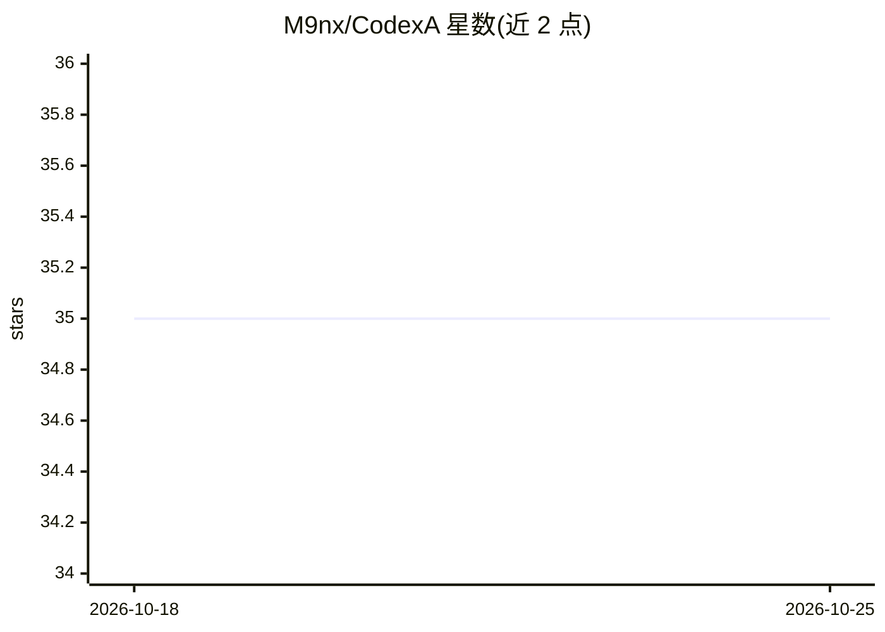

# M9nx/CodexA

⭐ 35 · Python · MIT · 推送 2026-10-22 · [GitHub](https://github.com/M9nx/CodexA) · [官网](https://codex-a.dev) · 个人维护

**本地语义代码搜索与索引引擎，供 AI 助手调用理解大型代码库**

面向 AI 编码助手（GitHub Copilot、Cursor、Cline 等）与开发者的本地代码智能引擎：索引仓库、用 tree-sitter 解析符号、sentence-transformers/FAISS 生成向量嵌入，提供语义/BM25/正则/混合检索、调用图、依赖图与代码质量分析，内置 Rust 搜索核心（HNSW）。通过 13 个工具以 CLI、HTTP 桥接服务器和 MCP 协议暴露给任意 AI agent，另提供 VS Code 扩展与编辑器插件。AI 命令可选配置 OpenAI/Ollama 提供方；PyTorch 后端约需 2 GB RAM，低内存可用 ONNX。

## 筛选速览

| 维度 | 判定 | 备注 |
|---|---|---|
| AI 角色 | `ai-ecosystem` | LLM/agent 周边工具 |
| 许可风险 | `permissive` | MIT |
| 部署形态 | `self-host` | docker 或自建部署 |
| 模型依赖 | local-ok | 支持本地模型 |
| 硬件要求 | — | 无带数字的原话,不猜 |
| 安装摩擦 | `low` | 无编译、无系统依赖或容器化 |
| 成熟度 | — | 结构信号不足 |

## 能力要点

- 语义/关键词/正则/混合（RRF）多模式代码检索，FAISS+HNSW 向量索引
- 13 个工具经 CLI、HTTP 桥接与 MCP 协议供 AI agent 调用
- tree-sitter AST 解析 10 种语言，支持调用图、依赖图与影响分析
- VS Code 扩展与 Zed/JetBrains/Neovim 等编辑器插件

## 适用场景

- 让 GitHub Copilot 等 AI 助手在大型代码库中做语义查找与上下文获取
- 本地索引并检索跨仓库工作区的代码
- 查看符号的调用关系、依赖与修改影响范围

## 场景标签

`语义搜索` · 领域:知识与检索

## 证据(README 行号)

> L14: **CodexA** is a lightweight developer intelligence engine designed to cooperate
> L16: tooling. It indexes codebases locally, performs semantic search, and exposes a
> L29: |**AI Agent Protocol**|13 built-in tools exposed via HTTP bridge, MCP server (13 tools with pagination/cursors), MC

## 星数曲线

2026-10-18 35 → 2026-10-25 35（+0）

---
*卡片 v1 · prompt 1.4 · 生成 2026-10-25 · 置信度 mid · 依据 README sha `7ece7d94258e` · [字段定义](../../DATASET.md)*
