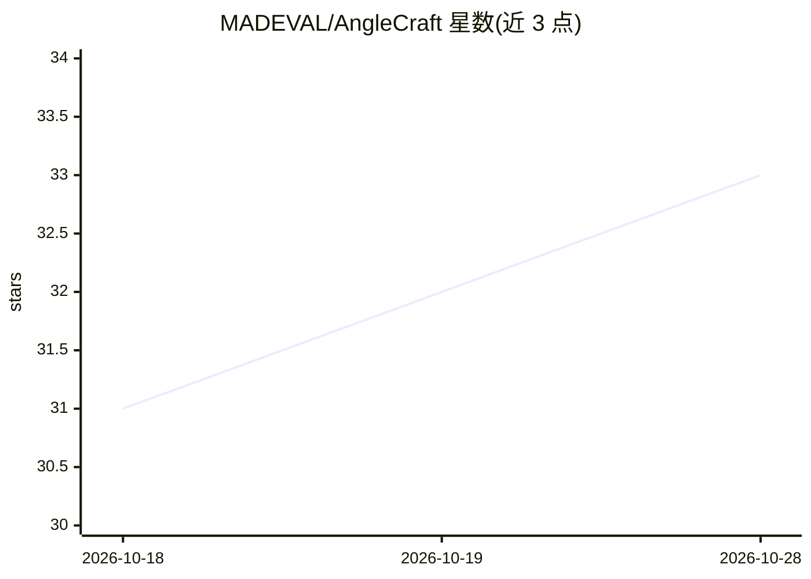

# MADEVAL/AngleCraft

⭐ 33 · MIT · 推送 2026-06-30 · [GitHub](https://github.com/MADEVAL/AngleCraft) · [官网](https://github.com/MADEVAL/AngleCraft) · 个人维护

**将枯燥专业话题转化为高吸引力内容的 AI 技能（7+2 新闻视角）**

以 SKILL.md 形式提供的 LLM agent 技能：内置 7 个主视角（如 Myth vs Reality、Paradox、Hidden Driver）与 2 个基础视角（历史/未来透镜），按目标（信任/传播/深度）与平台（短视频/长文/广告/LinkedIn）提供视角选择矩阵，并有 Quick 与 Deep 两种模式生成内容钩子。生成内容需通过惊讶度、具体性、好奇心缺口三项质检；拒绝伪科学、仇恨言论、赌博及未证实医疗主张等类别。安装方式为复制 SKILL.md 至 agent 技能目录。

## 筛选速览

| 维度 | 判定 | 备注 |
|---|---|---|
| AI 角色 | `ai-ecosystem` | LLM/agent 周边工具 |
| 许可风险 | `permissive` | MIT |
| 部署形态 | `None` |  |
| 模型依赖 | — | README 未给出锁定关系 |
| 硬件要求 | — | 无带数字的原话,不猜 |
| 安装摩擦 | `low` | 无编译、无系统依赖或容器化 |
| 成熟度 | — | 结构信号不足 |

## 能力要点

- 7 个主视角 + 2 个基础视角的新闻视角分类体系
- 按目标与平台组织的视角选择矩阵
- Quick/Deep 双模式（默认直接生成，复杂请求触发策略模式）
- 三项质检标准与五类内容拒绝边界

## 适用场景

- 为博客、视频脚本、社媒内容生成不同视角的开场钩子
- 内容策略规划时系统性选择切入视角
- 面向 B2B/产品发布等场景规划内容角度

## 场景标签

`提示工程` `AI 写作` · 领域:Agent 开发

## 证据(README 行号)

> L10: AngleCraft is an AI skill that transforms dry expert topics into high-engagement content by applying 7+2 journalist
> L65: Copy `SKILL.md` into your agent's skills directory:

## 星数曲线

2026-10-18 31 → 2026-10-28 33（+2）

---
*卡片 v1 · prompt 1.4 · 生成 2026-10-26 · 置信度 high · 依据 README sha `d980d5fab97b` · [字段定义](../../DATASET.md)*
