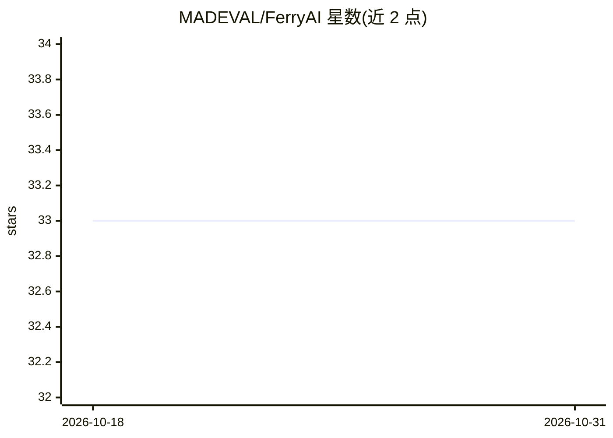

# MADEVAL/FerryAI

⭐ 33 · PHP · MIT · 推送 2026-10-18 · [GitHub](https://github.com/MADEVAL/FerryAI) · [官网](https://github.com/MADEVAL/FerryAI) · 个人维护

**PHP 8.3+ 进程内原生 AI 推理库：FFI 直驱 ONNX/GGUF/RubixML**

面向 PHP 开发者的推理库，通过 FFI 加载 onnxruntime.dll、llama.dll 等本地共享库，在同一 PHP 进程内提供 embeddings、向量检索、LLM chat 与流式输出、分类、内容审核与表格预测，无需 Python 或 HTTP 边车。向量存储支持 SQLite（含 sqlite-vec）与 PostgreSQL/pgvector 双后端；GBNF 语法与 JSON Schema 约束生成；内置 HuggingFace 模型下载、LRU 缓存与 SHA-256/Ed25519 校验，并提供 Laravel/Symfony 适配器。自述为早期版本 v0.1.1，公开 API 在 1.0 前可能变动；GPU（CUDA）为可选路径，缺失时自动回退 CPU。

## 筛选速览

| 维度 | 判定 | 备注 |
|---|---|---|
| AI 角色 | `ai-ecosystem` | LLM/agent 周边工具 |
| 许可风险 | `permissive` | MIT |
| 部署形态 | `None` |  |
| 模型依赖 | local-ok | 支持本地模型 |
| 硬件要求 | `cpu-ok` | |
| 安装摩擦 | `medium` | 含编译或系统依赖之一 |
| 成熟度 | `idea` | |

## 能力要点

- FFI 直连 ONNX Runtime 与 llama.cpp，进程内推理，无子进程/HTTP
- chat/stream + GBNF 语法与 JSON Schema→GBNF 结构化输出
- SQLite/sqlite-vec 与 PostgreSQL/pgvector 双向量存储后端
- HuggingFace 模型下载（SHA-256 + Ed25519 校验、LRU 缓存）与 ferry-ai check 环境诊断

## 适用场景

- 在 PHP/Laravel/Symfony 应用中直接嵌入 LLM 对话与 embeddings，不引入 Python 服务
- 用 SQLite 或 pgvector 构建语义检索/RAG 流程
- 本地 CPU/GPU 运行 GGUF 模型并做语法约束的 JSON 输出

## 场景标签

`推理引擎` · 领域:训练与推理

## 证据(README 行号)

> L5: **Run ONNX, GGUF, and RubixML models directly in PHP — no Python, no HTTP microservices, no Docker sidecars.**
> L55: FerryAI loads native shared libraries (`onnxruntime.dll`, `llama.dll`) directly via PHP FFI —
> L64: |**llama.cpp**|`chat()` `stream()` `streamResponse()`|Real LLM chat & token-by-token streaming. Runs on CPU and CUD

## 星数曲线

2026-10-18 33 → 2026-10-31 33（+0）

---
*卡片 v1 · prompt 1.4 · 生成 2026-10-25 · 置信度 high · 依据 README sha `1de037f8208f` · [字段定义](../../DATASET.md)*
