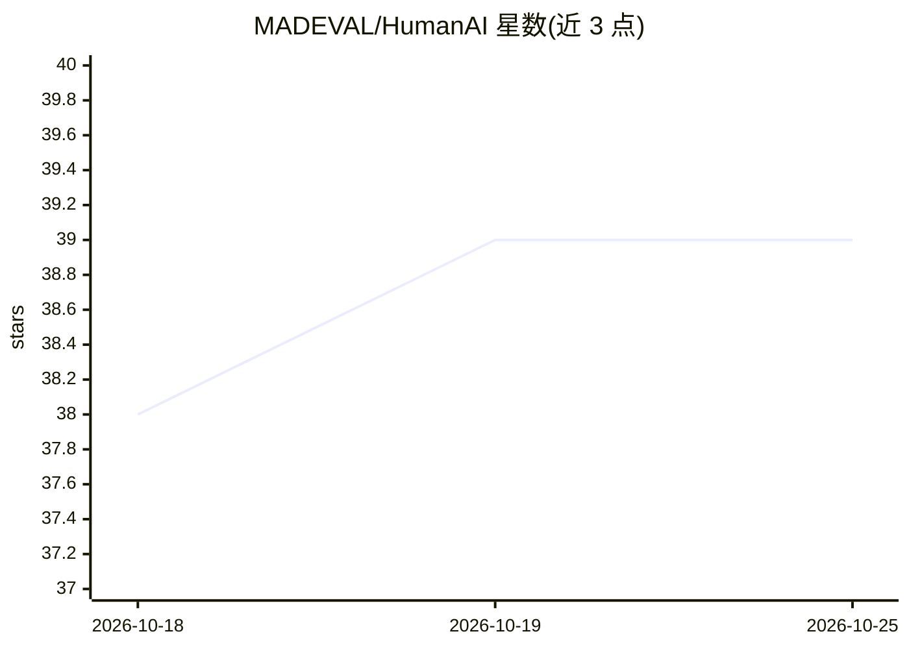

# MADEVAL/HumanAI

⭐ 39 · PowerShell · MIT · 推送 2026-07-12 · [GitHub](https://github.com/MADEVAL/HumanAI) · 个人维护 · 中文 README

**将机器生成文本改写为人味的 LLM 技能（9 语言，5 阶段流水线）**

面向任意具备系统提示能力的 LLM（GPT、Claude、Gemini、DeepSeek 等）的系统提示/技能包：把机器味文本改写为人类风格，通过 cleanup→specificity→tone→rhythm→proofread 五阶段流水线去除 AI 特征，支持 7 种语气画像与 9 种语言（含各语言的 AI 标记词库与语气规则）。提供全流程/单阶段/仅审计三种模式，可安装到 OpenCode 或 Claude Code 技能目录，或直接将 SKILL.md 作为系统提示使用。另有可选的 ZeroGPT API 外部检测评分做质量验证，并定义了与 RankWise、MindFluence 两个技能的联合管线规则。限制：完整技能功能需支持文件夹加载的技能系统；不用于法律/医疗/安全关键文本。

## 筛选速览

| 维度 | 判定 | 备注 |
|---|---|---|
| AI 角色 | `ai-native` | 本体是模型或模型工具 |
| 许可风险 | `permissive` | MIT |
| 部署形态 | `None` |  |
| 模型依赖 | — | README 未给出锁定关系 |
| 硬件要求 | — | 无带数字的原话,不猜 |
| 安装摩擦 | `low` | 无编译、无系统依赖或容器化 |
| 成熟度 | — | 结构信号不足 |

## 能力要点

- 5 阶段流水线：cleanup → specificity → tone → rhythm → proofread
- 7 种语气画像与 9 种语言的 AI 标记/烧词/语气规则
- 审计模式仅扫描标记 AI 痕迹不改写
- 三层质量验证：内置自评、EVAL.md、ZeroGPT 外部 API 检测（可选）

## 适用场景

- 把 AI 生成的博客/落地页文案改写成人类语感
- 检测并清除文本中的 AI 写作痕迹
- 作为内容生产管线（SEO→营销→人性化）的最后一环
- 修复机器翻译文本使其听起来像母语者所写

## 场景标签

`AI 写作` `提示工程` · 领域:Agent 开发

## 证据(README 行号)

> L11: An AI skill system that rewrites machine-generated text to sound human-written - across 9 languages. Detects and re
> L15: **HUMAN-AI** is a system prompt (skill) for any LLM - GPT, Claude, Gemini, DeepSeek, or any capable model. It trans
> L21: 1. **Load `SKILL.md`** as a system prompt into any LLM.

## 星数曲线

2026-10-18 38 → 2026-10-25 39（+1）

---
*卡片 v1 · prompt 1.4 · 生成 2026-10-25 · 置信度 high · 依据 README sha `4b764e7ba04c` · [字段定义](../../DATASET.md)*
