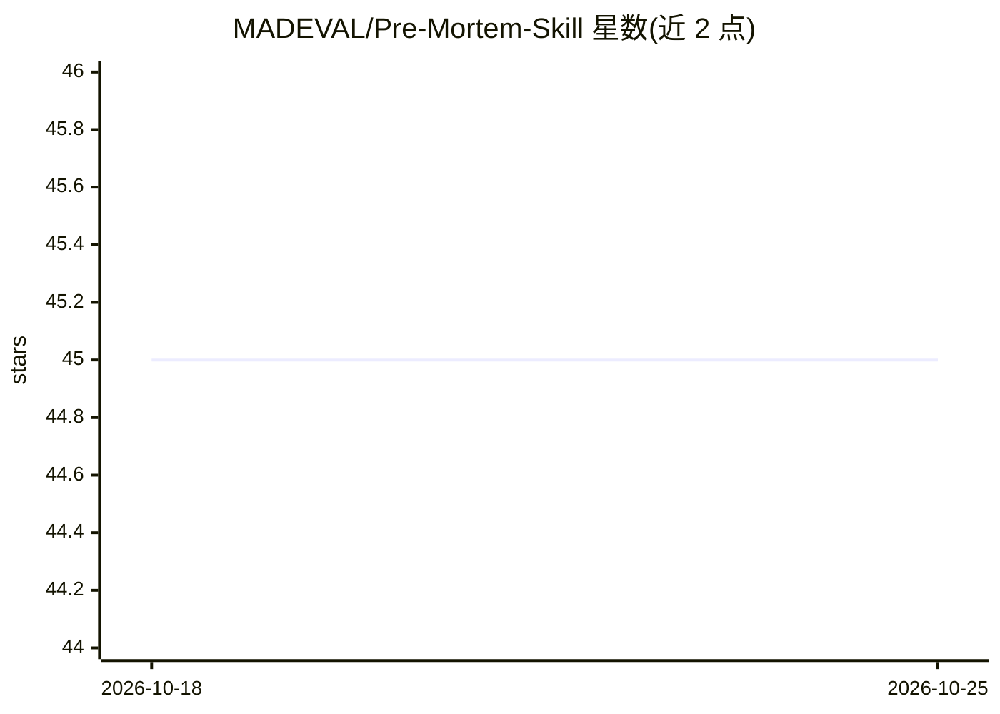

# MADEVAL/Pre-Mortem-Skill

⭐ 45 · GPL-3.0 · 推送 2026-06-30 · [GitHub](https://github.com/MADEVAL/Pre-Mortem-Skill) · [官网](https://github.com/MADEVAL/Pre-Mortem-Skill) · 个人维护

**假设计划已失败并倒推失败原因的 agent 技能（premortem）**

一个以 SKILL.md 形式分发的结构化失败分析工作流，基于 Gary Klein 的 premortem 方法：对计划、发布、招聘或战略决策执行 7 步协议，包括上下文核查、失败框架设定、含可能性×影响评分的失败清单、每条失败原因并行深挖的子代理、综合产出修订计划与启动前检查清单，并要求用户承诺一个具体行动。输出 HTML 可视报告与 markdown 转录。复制到 agent 技能目录或作为系统提示词使用。

## 筛选速览

| 维度 | 判定 | 备注 |
|---|---|---|
| AI 角色 | `ai-native` | 本体是模型或模型工具 |
| 许可风险 | `viral` | GPL-3.0 |
| 部署形态 | `None` |  |
| 模型依赖 | — | README 未给出锁定关系 |
| 硬件要求 | — | 无带数字的原话,不猜 |
| 安装摩擦 | `low` | 无编译、无系统依赖或容器化 |
| 成熟度 | — | 结构信号不足 |

## 能力要点

- 7 步 premortem 协议：上下文核查→失败框架→失败生成→并行深挖→综合→承诺→产物
- 强制包含≥2 个'平淡'失败原因以对冲基础率忽视
- 每条失败原因由子代理并行生成失败故事、隐含假设、预警信号与最廉价缓解措施
- 生成含可能性×影响四象限图的 HTML 报告与完整 markdown 转录

## 适用场景

- 产品发布或定价调整前做失败预演
- 重大招聘或战略转向决策前的风险排查
- 让 agent 在我说'premortem this'时自动执行失败分析流程

## 场景标签

`提示工程` · 领域:Agent 开发

## 证据(README 行号)

> L14: Given any plan, launch, hire, or strategic decision, this skill runs a 7-step protocol:
> L22: 4. **Parallel deep-dives** - one sub-agent per failure reason runs simultaneously, each producing: failure story, u
> L25: 7. **Artifacts** - a visual HTML report (with a likelihood × impact quadrant chart) and a full markdown transcript 

## 星数曲线

2026-10-18 45 → 2026-10-25 45（+0）

---
*卡片 v1 · prompt 1.4 · 生成 2026-10-25 · 置信度 high · 依据 README sha `5e0768b05b8b` · [字段定义](../../DATASET.md)*
