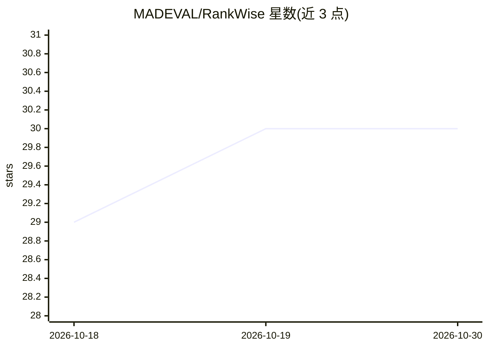

# MADEVAL/RankWise

⭐ 30 · Python · MIT · 推送 2026-07-12 · [GitHub](https://github.com/MADEVAL/RankWise) · 个人维护

**把任意 LLM 变成 SEO 内容工程师的提示词技能系统**

以 SKILL.md 系统提示词为核心的 SEO 内容引擎：将任意 LLM（GPT、Claude、Gemini、DeepSeek 等）转化为 SEO 策略与内容工程师，提供生成、改写、审计、Meta 生成、内容简报、单项修复六种模式，按 49 个排名因子（5 类、加权评分）对内容打分与优化。附带 Python validator（readsight）确定性计算 16 项可测指标，支持 9 种语言参数。限制：仅做内容层 SEO，不测速/Core Web Vitals 等。无 API key 与依赖，纯提示词工程。

## 筛选速览

| 维度 | 判定 | 备注 |
|---|---|---|
| AI 角色 | `ai-ecosystem` | LLM/agent 周边工具 |
| 许可风险 | `permissive` | MIT |
| 部署形态 | `library` | 以包/库形式分发 |
| 模型依赖 | — | README 未给出锁定关系 |
| 硬件要求 | — | 无带数字的原话,不猜 |
| 安装摩擦 | `low` | 无编译、无系统依赖或容器化 |
| 成熟度 | — | 结构信号不足 |

## 能力要点

- 49 因子加权 SEO 评分（CRITICAL×3 等 5 类权重）
- 六种模式：生成/改写/审计/Meta/简报/Quick-Fix
- Python validator 确定性计算 16/49 项指标，支持 9 种语言
- 纯提示词工程，无 API key、无依赖，可加载进任意 LLM

## 适用场景

- 让任意 LLM 按 49 因子生成或改写 SEO 内容
- 对现有文章做 SEO 审计并输出优先修复项
- 批量生成 meta 标签、alt 文本与 URL slug

## 场景标签

`提示工程` `AI 写作` · 领域:Agent 开发

## 证据(README 行号)

> L19: **RankWise** is a system prompt (skill) for any LLM - GPT, Claude, Gemini, DeepSeek, or any capable model. It trans
> L31: 1. **Load `SKILL.md`** as a system prompt into any LLM.

## 星数曲线

2026-10-18 29 → 2026-10-30 30（+1）

---
*卡片 v1 · prompt 1.4 · 生成 2026-10-26 · 置信度 mid · 依据 README sha `e1545c983abf` · [字段定义](../../DATASET.md)*
