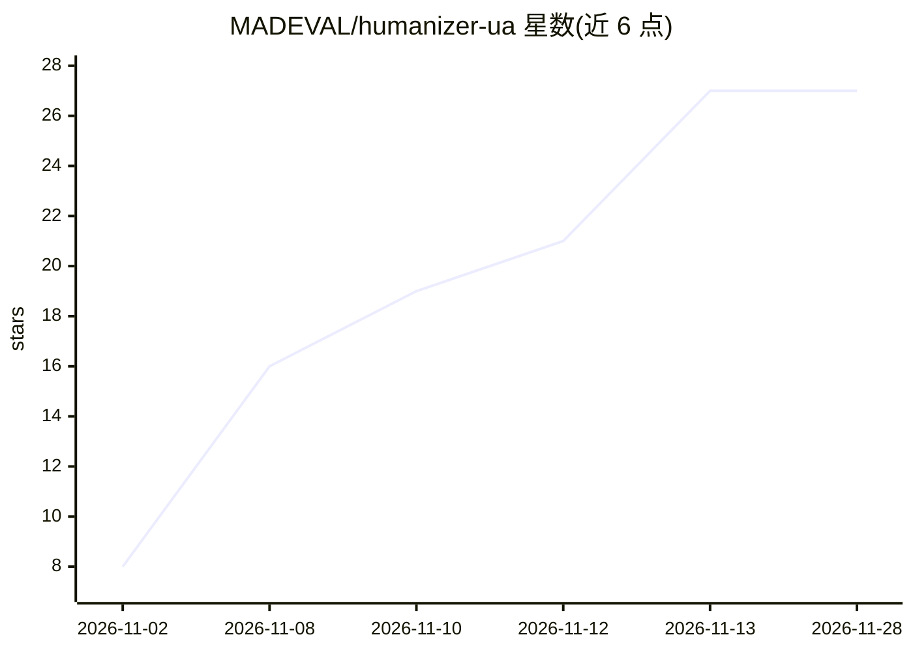

# MADEVAL/humanizer-ua

⭐ 27 · Python · MIT · 推送 2026-11-07 · [GitHub](https://github.com/MADEVAL/humanizer-ua) · 个人维护

**面向 agent 的乌克兰语文本去 AI 痕迹编辑技能包**

一个安装到 Claude/Cursor/OpenCode/Codex 等代理的 SKILL.md 格式技能：编辑乌克兰语文本，移除 AI 痕迹、公文腔、俄语式句法和外来语译词，同时保留事实、数字与作者声音。包含 30 项硬性禁令、12 项规范规则和 80 个分组标记，配备无依赖的启发式扫描器（Python 3.9+，无需 pip/模型/网络）输出规范/风格/结构评分。明确声明非 AI 检测器，不承诺通过 AI 检测，评测语料较小。

## 筛选速览

| 维度 | 判定 | 备注 |
|---|---|---|
| AI 角色 | `ai-ecosystem` | LLM/agent 周边工具 |
| 许可风险 | `permissive` | MIT |
| 部署形态 | `library` | 以包/库形式分发 |
| 模型依赖 | — | README 未给出锁定关系 |
| 硬件要求 | — | 无带数字的原话,不猜 |
| 安装摩擦 | `low` | 无编译、无系统依赖或容器化 |
| 成熟度 | — | 结构信号不足 |

## 能力要点

- SKILL.md 技能包，支持 OpenCode/Cursor/Claude/Codex 全局或项目级安装
- 无依赖扫描器：规范/风格/结构分项评分、30 禁令、33 个自动标记
- 事实锁机制：数字、日期、姓名、引文和情态在编辑中不变
- 提供 CI 门禁、规则导出 JSON、自检等配套脚本

## 适用场景

- 让 AI 代理把机器味的乌克兰语文本改写得更自然
- 发布前审计营销/新闻/科学等体裁文本的规范与风格问题
- 为 CI 流程添加文本质量门禁（低于阈值即失败）

## 场景标签

`AI 写作` · 领域:内容生成

## 证据(README 行号)

> L11: Скіл для агентів: редагує український текст, прибирає сліди ШІ, канцелярит, суржик, русизми й кальки. Зміст, факти 
> L85: Глобальні каталоги теж працюють: `~/.config/opencode/skills`, `~/.cursor/skills`, `~/.claude/skills`, `~/.codex/ski
> L191: - Будь-який LLM із системним промптом або полем custom instructions.

## 星数曲线

2026-11-02 8 → 2026-11-28 27（+19）

---
*卡片 v1 · prompt 1.4 · 生成 2026-11-18 · 置信度 mid · 依据 README sha `8dbf9053f067` · [字段定义](../../DATASET.md)*
