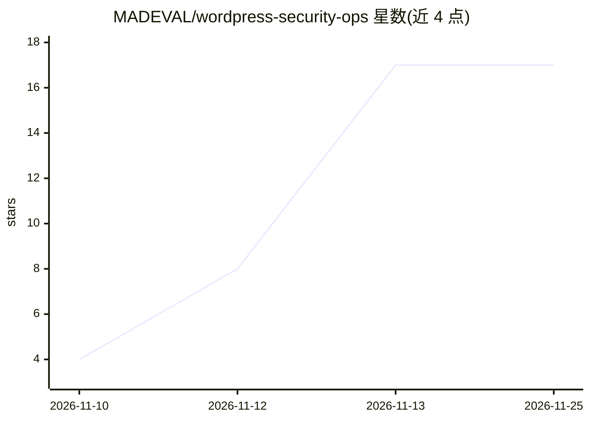

# MADEVAL/wordpress-security-ops

⭐ 17 · PHP · MIT · 推送 2026-11-07 · [GitHub](https://github.com/MADEVAL/wordpress-security-ops) · 个人维护

**WordPress 安全运维 agent 技能：审计、加固、入侵响应与修复**

面向 Claude Code/OpenCode 等 agent 框架的可安装技能包，覆盖 WordPress 站点的安全审计、加固、事件响应、取证与恢复全周期，按 7 种模式运行并以 7 部分输出契约返回结果。以 BotBlocker Security 为可选控制平面，无插件路径可用 WP-CLI、SSH、数据库、主机日志或后台 UI。写入操作受备份、dry-run、人工批准与后置检查门控，默认 MCP 只读。当前版本 0.1.1，写入流程仍在逐步添加。

## 筛选速览

| 维度 | 判定 | 备注 |
|---|---|---|
| AI 角色 | `ai-ecosystem` | LLM/agent 周边工具 |
| 许可风险 | `permissive` | MIT |
| 部署形态 | `None` |  |
| 模型依赖 | — | README 未给出锁定关系 |
| 硬件要求 | — | 无带数字的原话,不猜 |
| 安装摩擦 | `low` | 无编译、无系统依赖或容器化 |
| 成熟度 | `idea` | |

## 能力要点

- 7 种模式（audit/harden/incident/forensic/recover/monitor/report），统一 7 部分输出契约
- 插件无关路径：仅凭 WP-CLI/SSH/数据库/主机日志/后台 UI 即可运行
- 写入操作受备份、dry-run、人工批准与后置检查门控，PII 始终脱敏
- 取证模式提供证据哈希、时间线、IOC 与证据链

## 适用场景

- 让 agent 用自然语言审计我的 WordPress 站点并出优先级报告
- 网站被黑后让 agent 保全证据、遏制并清理恶意代码
- 对站点做加固配置并设置监控告警
- 给客户出具技术报告与修复计划

## 场景标签

`网络安全` · 领域:学习与行业

## 证据(README 行号)

> L7: Operational security skill for WordPress: audit, harden, investigate and repair hacked sites.
> L55: python install.py --target opencode
> L59: Targets: `claude`, `opencode`, `agents`, `codex`, `project`, `all`.

## 星数曲线

2026-11-10 4 → 2026-11-25 17（+13）

---
*卡片 v1 · prompt 1.4 · 生成 2026-11-18 · 置信度 high · 依据 README sha `293020d0856a` · [字段定义](../../DATASET.md)*
