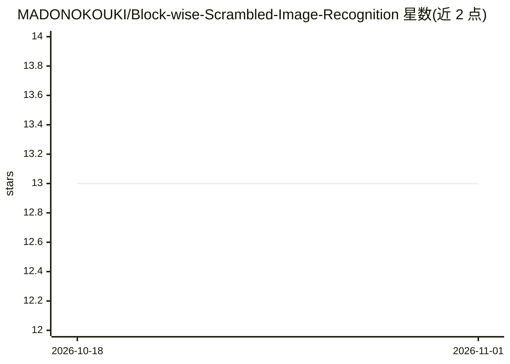

# MADONOKOUKI/Block-wise-Scrambled-Image-Recognition

⭐ 13 · Python · MIT · 推送 2026-09-30 · [GitHub](https://github.com/MADONOKOUKI/Block-wise-Scrambled-Image-Recognition) · [官网](https://madonokouki.github.io/projects/blockscramble/) · 组织维护

**论文官方代码：识别按块置乱加密图像的适配网络**

AAAI-20 AIoT Workshop 论文 "Block-wise Scrambled Image Recognition Using Adaptation Network" 的官方 PyTorch 实现。提供 ELE 按块置乱方案（每块独立密钥加块位置打乱）、LE/EtC 等置乱实现（含精确逆变换），以及置于分类器前的适配网络 ELE-AdaptNet，用于在密钥置乱的 CIFAR-10/100 图像上训练分类。客户端可用密钥隐藏图像内容后再交给云端模型。提供可安装的 Python 库 blockscramble、单脚本复现实验（train.py 覆盖 24 组训练配置）与 Colab 快速开始；完整 305 epoch 训练需 CUDA GPU，快速开始可在 CPU/MPS 上运行。原作者为早稻田大学与 AIST 研究人员。

## 筛选速览

| 维度 | 判定 | 备注 |
|---|---|---|
| AI 角色 | `ai-native` | 本体是模型或模型工具 |
| 许可风险 | `permissive` | MIT |
| 部署形态 | `library` | 以包/库形式分发 |
| 模型依赖 | — | README 未给出锁定关系 |
| 硬件要求 | — | 无带数字的原话,不猜 |
| 安装摩擦 | `medium` | 含编译或系统依赖之一 |
| 成熟度 | — | 结构信号不足 |

## 能力要点

- ELE/LE/EtC/BlockShuffle 置乱实现，支持 PIL/numpy/tensor 输入与精确逆变换（EtC 默认除外）
- ELE-AdaptNet 适配网络（逐块子网络、可学习伪置换矩阵、pixel-shuffle）
- train.py 单脚本复现论文 Table 3 全部 24 组训练配置
- 测试逐位校验重构代码与原始研究代码输出一致

## 适用场景

- 复现论文中置乱图像分类实验
- 研究隐私保护（加密/置乱）图像的云端机器学习方案
- 在自定义 CNN 前接入适配网络处理置乱图像

## 场景标签

 · 领域:计算机视觉/隐私保护机器学习

## 证据(README 行号)

> L3: Official PyTorch implementation of the paper *Block-wise Scrambled Image Recognition Using Adaptation Network* (AAAI
> L19: **TL;DR** A client can hide what its images show from a cloud-side model developer by scrambling every
> L22: space than LE and EtC), and **ELE-AdaptNet**, an adaptation network placed in front of a standard classifier.

## 星数曲线

2026-10-18 13 → 2026-11-01 13（+0）

---
*卡片 v1 · prompt 1.4 · 生成 2026-10-31 · 置信度 high · 依据 README sha `df784315abc2` · [字段定义](../../DATASET.md)*
