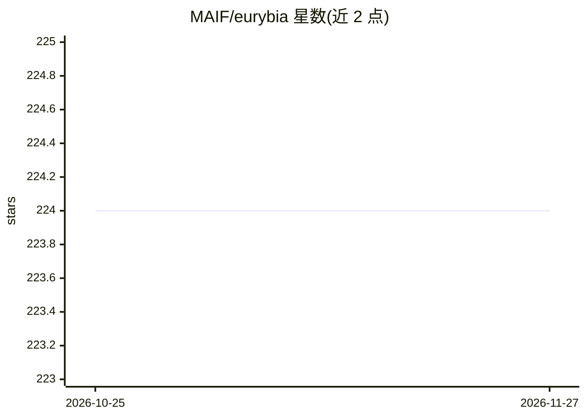

# MAIF/eurybia

⭐ 224 · Jupyter Notebook · Apache-2.0 · 推送 2026-11-13 · [GitHub](https://github.com/MAIF/eurybia) · [官网](https://maif.github.io/eurybia/) · 组织维护

**为数据科学团队检测模型数据漂移并生成校验报告**

Python 库，检测数据漂移与模型漂移，并在模型上线前校验生产数据与训练数据的一致性。核心机制是用二分类 datadrift classifier 区分基线与生产数据集，以 AUC 衡量漂移程度，并生成包含特征重要性、分布对比、性能演化的 HTML 报告。面向数据科学家与数据分析师，服务模型监控、审计与 AI 治理；可用 Airflow 等调度器做周期监控。要求 Python 3.11–3.14 与 Shapash 2.10+；Roadmap 显示 Concept Drift 与 API 模式尚未完成。

## 筛选速览

| 维度 | 判定 | 备注 |
|---|---|---|
| AI 角色 | `ai-native` | 本体是模型或模型工具 |
| 许可风险 | `permissive` | Apache-2.0 |
| 部署形态 | `library` | 以包/库形式分发 |
| 模型依赖 | — | README 未给出锁定关系 |
| 硬件要求 | — | 无带数字的原话,不猜 |
| 安装摩擦 | `low` | 无编译、无系统依赖或容器化 |
| 成熟度 | — | 结构信号不足 |

## 能力要点

- 基于 datadrift classifier 的 AUC 指标量化数据漂移
- 生成动态 HTML 报告，展示特征重要性与分布对比
- 支持部署前数据校验与模型性能演化跟踪
- 可配合 Airflow 等调度器做周期性漂移监控

## 适用场景

- 模型上线前校验生产数据与训练数据分布一致性
- 用调度器定期监控生产环境的数据漂移
- 生成报告供数据分析师与非数据用户讨论审计

## 场景标签

`MLOps` · 领域:训练与推理

## 证据(README 行号)

> L39: **Eurybia** is a Python library which aims to help in :
> L40:  - **Detecting data drift and model drift**
> L138: **Eurybia** works mainly with a binary classification model (named datadrift classifier) that tries to predict whe

## 星数曲线

2026-10-25 224 → 2026-11-27 224（+0）

---
*卡片 v1 · prompt 1.4 · 生成 2026-11-25 · 置信度 high · 依据 README sha `26224ac215f2` · [字段定义](../../DATASET.md)*
