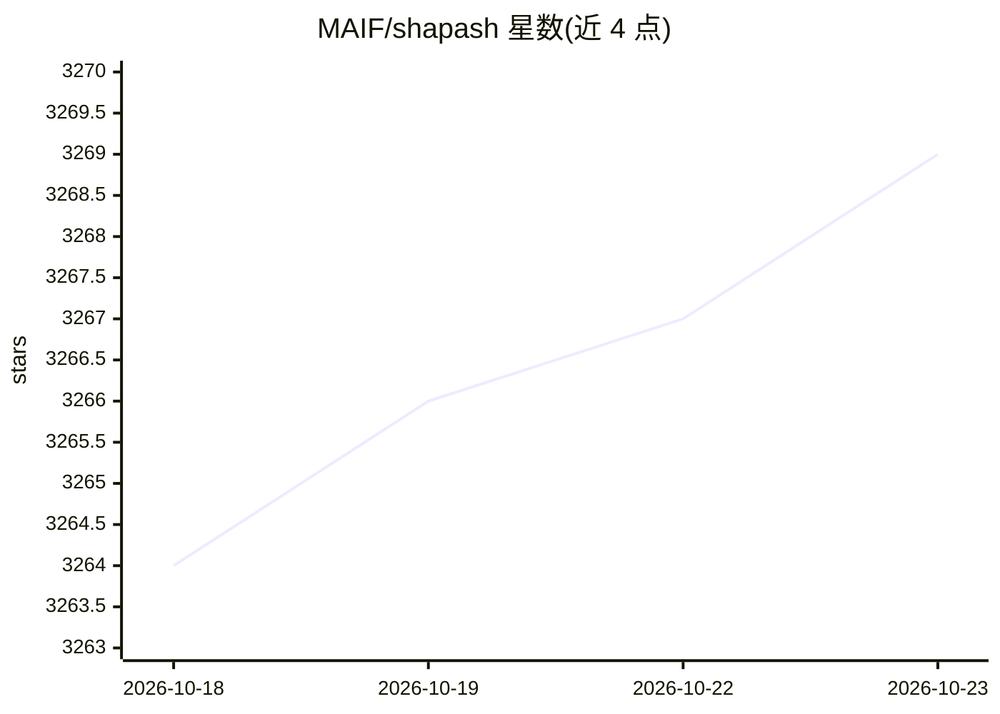

# MAIF/shapash

⭐ 3,269 · Jupyter Notebook · Apache-2.0 · 推送 2026-10-21 · [GitHub](https://github.com/MAIF/shapash) · [官网](https://maif.github.io/shapash/) · 组织维护

**Python 库：让机器学习模型可解释，产出 Webapp 与审计报告**

MAIF 维护的机器学习可解释性 Python 库，作为 SHAP/Lime 等贡献计算库的上层封装：编译模型与数据后生成交互式 Webapp（全局/局部解释导航、特征筛选、样本挑选）、汇总局部解释并用明确标签展示、输出独立 HTML 审计报告供合规/风控团队共享。兼容回归/二分类/多分类及 CatBoost/Xgboost/LightGBM/Sklearn 等模型，支持 category-encoders 与 ColumnTransformer，提供 SmartPredictor 对象以 API/批处理方式部署局部解释，并含稳定性/一致性/紧凑性三个解释质量指标。需 Python 3.11-3.14。

## 筛选速览

| 维度 | 判定 | 备注 |
|---|---|---|
| AI 角色 | `ai-ecosystem` | LLM/agent 周边工具 |
| 许可风险 | `permissive` | Apache-2.0 |
| 部署形态 | `library` | 以包/库形式分发 |
| 模型依赖 | — | README 未给出锁定关系 |
| 硬件要求 | — | 无带数字的原话,不猜 |
| 安装摩擦 | `low` | 无编译、无系统依赖或容器化 |
| 成熟度 | — | 结构信号不足 |

## 能力要点

- 生成交互式 Webapp，在全局与局部解释间导航
- 生成独立 HTML 审计报告，可共享给合规/风控等非数据团队
- SmartPredictor 对象支持 API/批处理模式部署局部解释
- 基于 SHAP/Lime 后端计算贡献，兼容多种主流模型与编码器

## 适用场景

- 为已训练模型生成全局与局部解释可视化
- 向非技术干系人共享模型解释与审计文档
- 在生产环境以 API/批处理方式提供预测附带解释

## 场景标签

 · 领域:机器学习可解释性/可信 AI

## 证据(README 行号)

> L31: Shapash is a Python library designed to **make machine learning interpretable and comprehensible for everyone**. It
> L93: **Shapash** is an overlay package for libraries focused on model interpretability. It uses Shap or Lime backend

## 星数曲线

2026-10-18 3,264 → 2026-10-23 3,269（+5）

---
*卡片 v1 · prompt 1.4 · 生成 2026-10-20 · 置信度 high · 依据 README sha `d6db020475ac` · [字段定义](../../DATASET.md)*
